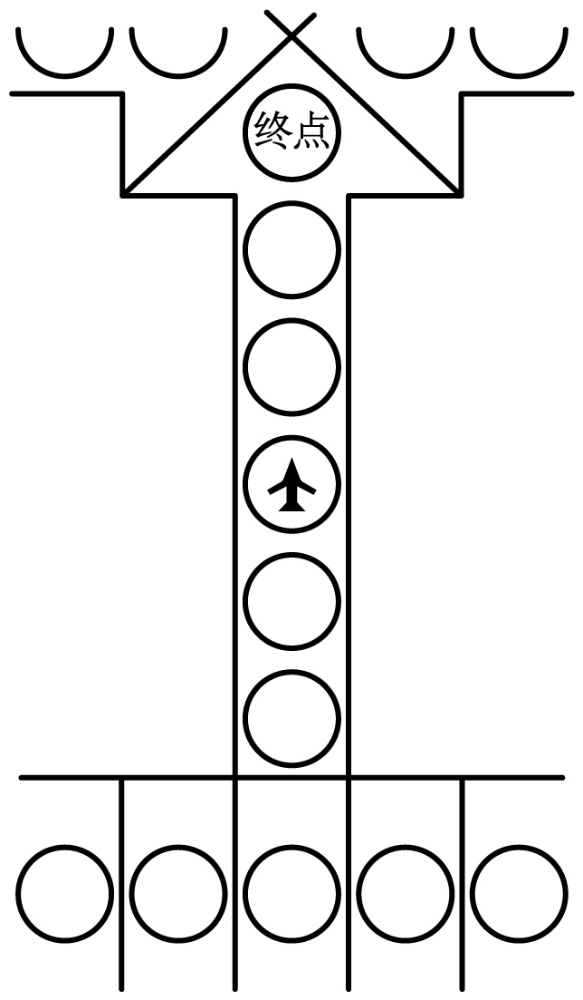

# Mathematics - 题目 2183

**ID**: 505132b8eb1b4edab524c0fd1fa4177e
**年级**: Grade 12
**难度**: Medium-Hard
**题型**: Multiple-choice

## 题目
飞行棋是一种家喻户晓的竞技游戏，玩家根据骰子（骰子为均匀的正六面体）正面朝上的点数确定飞机往前走的步数，刚好走到终点处算“到达”，如果玩家投掷的骰子点数超出到达终点所需的步数，则飞机须往回走超出点数对应的步数.​​​​​​​‌在一次游戏中，飞机距终点只剩3步（如图所示），设该玩家到达终点时投掷骰子的次数为 $X$ ，则 $E\left ({X}\right )=$ （      ）

## 解答

1. 玩家投掷1次即可到达终点的方法是掷出3点，故 $P\left ({X=1}\right )=\frac {1}{6}$ .
2. 玩家投掷2次即可到达终点的方法是掷出 $\left ({1,2}\right )$ ， $\left ({2,1}\right )$ ， $\left ({4,1}\right )$ ， $\left ({5,2}\right )$ ， $\left ({6,3}\right )$ ，故 $P\left ({X=2}\right )=\frac {5}{36}$ .
3. 玩家投掷3次即可到达终点的方法是掷出 $\left ({1,1,1}\right )$ ， $\left ({1,3,1}\right )$ ， $\left ({1,4,2}\right )$ ， $\left ({1,5,3}\right )$ ， $\left ({1,6,4}\right )$ ， $\left ({2,2,1}\right )$ ， $\left ({2,3,2}\right )$ ， $\left ({2,4,3}\right )$ ， $\left ({2,5,4}\right )$ ， $\left ({2,6,5}\right )$ ， $\left ({4,2,1}\right )$ ， $\left ({4,3,2}\right )$ ， $\left ({4,4,3}\right )$ ， $\left ({4,5,4}\right )$ ， $\left ({4,6,5}\right )$ ， $\left ({5,1,1}\right )$ ， $\left ({5,3,1}\right )$ ， $\left ({5,4,2}\right )$ ， $\left ({5,5,3}\right )$ ， $\left ({5,6,4}\right )$ ， $\left ({6,1,2}\right )$ ， $\left ({6,2,1}\right )$ ， $\left ({6,4,1}\right )$ ， $\left ({6,5,2}\right )$ ， $\left ({6,6,3}\right )$ ，故 $P\left ({X=3}\right )=\frac {5{^{2}}}{6{^{3}}}$ .
4. 设玩家投掷 $n$ 次即可到达终点，那么第 $n$ 次掷得的点数可以为 $1,2,3,4,5$ ，分别记作 $\left ({\cdots ,1}\right )$ ， $\left ({\cdots ,2}\right )$ ， $\left ({\cdots ,3}\right )$ ， $\left ({\cdots ,4}\right )$ ， $\left ({\cdots ,5}\right )$ ，则玩家投掷 $n+1$ 次的基本事件是投掷 $n$ 次的 $6$ 倍，能到达终点的掷法：之前的 $\left ({\cdots ,1}\right )$ 对应 $\left ({\cdots ,2,1}\right )$ ， $\left ({\cdots ,3,2}\right )$ ， $\left ({\cdots ,4,3}\right )$ ， $\left ({\cdots ,5,4}\right )$ ， $\left ({\cdots ,6,5}\right )$ ； $\left ({\cdots ,2}\right )$ 对应 $\left ({\cdots ,1,1}\right )$ ， $\left ({\cdots ,3,1}\right )$ ， $\left ({\cdots ,4,2}\right )$ ， $\left ({\cdots ,5,3}\right )$ ， $\left ({\cdots ,6,4}\right )$ ； $\left ({\cdots ,3}\right )$ 对应 $\left ({\cdots ,1,2}\right )$ ， $\left ({\cdots ,2,1}\right )$ ， $\left ({\cdots ,4,1}\right )$ ， $\left ({\cdots ,5,2}\right )$ ， $\left ({\cdots ,6,3}\right )$ ； $\left ({\cdots ,4}\right )$ 对应 $\left ({\cdots ,1,3}\right )$ ， $\left ({\cdots ,2,2}\right )$ ， $\left ({\cdots ,3,1}\right )$ ， $\left ({\cdots ,5,1}\right )$ ， $\left ({\cdots ,6,2}\right )$ ； $\left ({\cdots ,5}\right )$ 对应 $\left ({\cdots ,1,4}\right )$ ， $\left ({\cdots ,2,3}\right )$ ， $\left ({\cdots ,3,2}\right )$ ， $\left ({\cdots ,4,1}\right )$ ， $\left ({\cdots ,6,1}\right )$ .是投掷 $n$ 次即可到达终点的 $5$ 倍.
5. 所以 $P\left ({X=n}\right )$ 是以 $\frac {1}{6}$ 为首项，以 $\frac {5}{6}$ 为公比的等比数列.所以 $P\left ({X=n}\right )=\frac {1}{6}\times {\left({\frac {5}{6}}\right)^{n-1}}$ .
6. 所以 $E\left ({X}\right )=\frac {1}{6}+\frac {2}{6}\times \frac {5}{6}+\frac {3}{6}\times {\left({\frac {5}{6}}\right)^{2}}+\frac {4}{6}\times {\left({\frac {5}{6}}\right)^{3}}+\cdots $
7. 即 $6E\left ({X}\right )=1+2\times \frac {5}{6}+3\times {\left({\frac {5}{6}}\right)^{2}}+4\times {\left({\frac {5}{6}}\right)^{3}}+\cdots $
8. 两边同乘以 $\frac {5}{6}$ 得： $5E\left ({X}\right )=\hspace{-0.5em}\begin{array}{}\;&\;\end{array}\hspace{-0.5em}\frac {5}{6}+2\times {\left({\frac {5}{6}}\right)^{2}}+3\times {\left({\frac {5}{6}}\right)^{3}}+\cdots $
9. 两式相减得： $E\left ({X}\right )=1+\frac {5}{6}+{\left({\frac {5}{6}}\right)^{2}}+{\left({\frac {5}{6}}\right)^{3}}+\cdots $  $=\frac {1}{1-\frac {5}{6}}=6$ .
10. 故选：D

## 知识点

**中文**:
  - 数列求和方法之错位相减法

**English**:
  - Offset Subtraction Method

---
