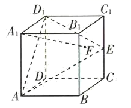

# Mathematics - 题目 413

**ID**: 52f3dbca53134ed59abef1523cb0171b
**年级**: Grade 12
**难度**: Medium-Hard
**题型**: Multiple-choice

## 题目
在正方体 $ABCD-A{{}_{1}}B{{}_{1}}C{{}_{1}}D{{}_{1}}$ 中， $E$ 是棱 $CC{{}_{1}}$ 的中点， $F$ 是侧面 $BCC{{}_{1}}B{{}_{1}}$ 内的动点，且 $A{{}_{1}}F/\mskip-4mu/$ 平面 $D{{}_{1}}AE$ ，则 $A{{}_{1}}F$ 与平面 $BCC{{}_{1}}B{{}_{1}}$ 所成角的正切值 $t$ 构成的集合是（      ）​​​​​​​‌

## 解答

1. 设平面 $AD{{}_{1}}E$ 与直线 $BC$ 交于点 $G$ ，连接 $AG,EG$ ，则 $G$ 为 $BC$ 的中点.
2. 分别取 $B{{}_{1}}B,B{{}_{1}}C{{}_{1}}$ 的中点 $M,N$ ，连接 $A{{}_{1}}M,MN,A{{}_{1}}N$ ，则 $A{{}_{1}}M//D{{}_{1}}E$ ，
3. ∵ $A{{}_{1}}M\not\subset $ 平面 $D{{}_{1}}AE$ ， $D{{}_{1}}E\subset $ 平面 $D{{}_{1}}AE$ ，
4. 
5. ∴ $A{{}_{1}}M//$ 平面 $D{{}_{1}}AE$ ，同理可得 $MN//$ 平面 $D{{}_{1}}AE$ .
6. ∵ $A{{}_{1}}M,MN$ 是平面 $A{{}_{1}}MN$ 内的两条相交直线，
7. ∴平面 $A{{}_{1}}MN//$ 平面 $D{{}_{1}}AE$ ，且 $A{{}_{1}}F//$ 平面 $D{{}_{1}}AE$ ，
8. 可得直线 $A{{}_{1}}F\subset $ 平面 $A{{}_{1}}MN$ ，即点 $F$ 是线段 $MN$ 上的动点.
9. 设直线 $A{{}_{1}}F$ 与平面 $BCC{{}_{1}}B{{}_{1}}$ 所成角为 $θ$ ，运动点 $F$ 并加以观察，可得：
10. 当点 $F$ 与点 $M$ （或 $N$ ）重合时， $A{{}_{1}}F$ 与平面 $BCC{{}_{1}}B{{}_{1}}$ 所成角等于 $\angle A{{}_{1}}MB{{}_{1}}$ ，此时所成角 $θ$ 达到最小值，满足 ${\tan}θ=\frac {A{{}_{1}}B{{}_{1}}}{B{{}_{1}}M}=2$ ；
11. 当点 $F$ 与 $MN$ 中点重合时， $A{{}_{1}}F$ 与平面 $BCC{{}_{1}}B{{}_{1}}$ 所成角达到最大值，
12. 此时 ${\tan}θ=\frac {A{{}_{1}}B{{}_{1}}}{B{{}_{1}}F}=\frac {A{{}_{1}}B{{}_{1}}}{\frac {\sqrt {2}}{2}B{{}_{1}}M}=2\sqrt {2}$ ，∴ $A{{}_{1}}F$ 与平面 $BCC{{}_{1}}B{{}_{1}}$ 所成角的正切值 $t$ 构成的集合为 $\left \{t|2\mathrm{\leqslant }t\mathrm{\leqslant }2\sqrt {2}\right \}$ ，故选D.

## 知识点

**中文**:
  - 平面与平面平行的判定
  - 平面与平面平行的性质
  - 直线与平面所成的角

**English**:
  - Plane-Plane Parallelism Determination
  - Properties of Plane-Plane Parallelism
  - Line-Plane Angle

---
