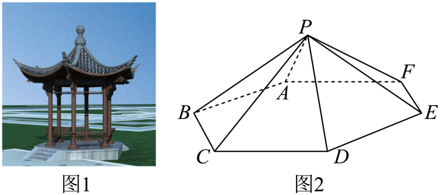

# Mathematics - 题目 2473

**ID**: c2b481df2b0849c5a460c5db9df72639
**年级**: Grade 12
**难度**: Medium-Hard
**题型**: Multiple-choice

## 题目
中国古建筑闻名于世，源远流长.​​​​​​​‌如图1，某公园的六角亭是中国常见的一种供休闲的古建筑，六角亭屋顶的结构示意图可近似地看作如图2所示的六棱锥 $P-ABCDEF$ .该公园管理处准备用风铃装饰六角亭屋顶 $P-ABCDEF$ 的六个顶点A，B，C，D，E，F，现有四种不同形状的风铃可供选用，则在相邻的两个顶点挂不同形状的风铃的条件下，顶点A与C处挂同一种形状的风铃的概率为（      ）

## 解答

1. 记事件G：相邻的两个顶点挂不同形状的风铃，事件H：A与C处挂同一种形状的风铃.
2. 对于事件G，包含的情况可分以下三类：
3. （1）当A，C，E挂同一种形状的风铃时，有4种挂法，
4. 此时B，D，F各有3种挂法，故不同的挂法共有4×3×3×3=108种；
5. （2）当A，C，E挂两种不同形状的风铃时，有 ${\rm{C}}{{}_{3}^{2}}{\rm{A}}{{}_{4}^{2}}$ 种挂法，
6. 此时B，D，F有3×2×2种挂法，故不同的挂法共有 ${\rm{C}}{{}_{3}^{2}}{\rm{A}}{{}_{4}^{2}}\times 3\times 2\times 2=432$ 种；
7. （3）当A，C，E挂三种不同形状的风铃时，有 ${\rm{A}}{{}_{4}^{3}}$ 种挂法，
8. 此时B，D，F各有2种挂法，故不同的挂法共有 ${\rm{A}}{{}_{4}^{3}}\times 2\times 2\times 2=192$ 种；
9. 综上，总计有108+432+192=732种挂法，即 $n\left ({G}\right )=732$ ；
10. 当顶点A与C挂同一种形状的风铃，且相邻两顶点挂不同形状的风铃时，分以下两类：
11. （1）A，C，E挂同一种形状的风铃，由前面解析可知，此时不同的挂法有108种；
12. （2）当A，C挂同一种形状的风铃，E挂其他形状的风铃时，有 ${\rm{A}}{{}_{4}^{2}}$ 种挂法，
13. 此时B，D，F有3×2×2种挂法，故不同的挂法共有 ${\rm{A}}{{}_{4}^{2}}\times 3\times 2\times 2=144$ 种；
14. 综上，总计有108+144=252种挂法，即 $n\left ({GH}\right )=252$ ；
15. 故 $P\left ({H\left |{G}\right .}\right )=\frac {n\left ({GH}\right )}{n\left ({G}\right )}=\frac {252}{732}=\frac {21}{61}$ .
16. 故选C.

## 知识点

**中文**:
  - 概率与计数原理相结合的应用题

**English**:
  - Combined Problems

---
