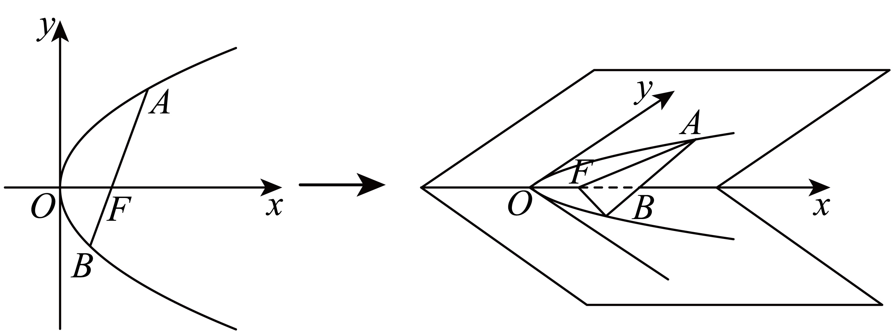

# Mathematics - 题目 278

**ID**: ce83321f26fe4f16bed1ae892e5fdcd6
**年级**: Grade 12
**难度**: Medium-Hard
**题型**: Multiple-choice

## 题目
如图，画在纸面上的抛物线 $y{^{2}}=8x$ 过焦点F的弦 $AB$ 长为9，则沿x轴将纸面折成平面角为60度的二面角后，空间中线段 $AB$ 的长为（      ）​​​​​​​‌

## 解答

1. $F\left ({2,0}\right )$ ，设直线 $AB$ 为 $x=my+2\left ({m>0}\right )$ ， $A\left ({x{{}_{1}},y{{}_{1}}}\right ),B\left ({x{{}_{2}},y{{}_{2}}}\right )$ ，
2. 联立 $x=my+2\left ({m>0}\right )$ 与 $y{^{2}}=8x$ 可得 $y{^{2}}-8my-16=0$ ，
3. 则 $y{{}_{1}}+y{{}_{2}}=8m$ ，则 $x{{}_{1}}+x{{}_{2}}=m\left ({y{{}_{1}}+y{{}_{2}}}\right )+4=8m{^{2}}+4$ ，
4. 故 $\left |{AB}\right |=x{{}_{1}}+x{{}_{2}}+p=m\left ({y{{}_{1}}+y{{}_{2}}}\right )+4+4=8m{^{2}}+8=9$ ，解得 $m=\frac {\sqrt {2}}{4}$ ，
5. 故 $y{^{2}}-2\sqrt {2}y-16=0$ ，解得 $y{{}_{1}}=4\sqrt {2},y{{}_{2}}=-2\sqrt {2}$ ，
6. 故 $A\left ({4,4\sqrt {2}}\right ),B\left ({1,-2\sqrt {2}}\right )$ ，
7. 如图，建立空间直角坐标系，过 $\mathrm{A}$ 作 $AN⊥$ 平面 $xoy$ 于 $N$ ，过 $N$ 作 $NH\bot x$ 于 $H$ ，连接 $AH$ ，
8. 由于 $AN\bot x$ 轴，且 $NH\bot x$ 轴， $AN\cap AH=A$ ，故 $x$ 轴 $\bot $ 平面 $ANH$ ，
9. $AH\subset $ 平面 $ANH$ ，故 $AH\bot x$ 轴，则 $\angle AHN=60{^{\circ }}$
10. 由于在直角坐标系中 $A\left ({4,4\sqrt {2}}\right ),B\left ({1,-2\sqrt {2}}\right )$ ，
11. 故 $OH=4,AH=4\sqrt {2}$ ，
12. 因此在直角三角形 $ANH$ 中， $HN=\frac {1}{2}AH=2\sqrt {2},AN=\frac {\sqrt {3}}{2}AH=2\sqrt {6}$ ，
13. 因此在空间直角坐标系中， $A\left ({4,-2\sqrt {2},2\sqrt {6}}\right ),B\left ({1,-2\sqrt {2},0}\right )$ ，
14. 故 $\left |{AB}\right |=\sqrt {{\left({4-1}\right)^{2}}+0{^{2}}+{\left({2\sqrt {6}}\right)^{2}}}=\sqrt {33}$ ，
15. 故选B.
16. 

## 知识点

**中文**:
  - 直线与抛物线的位置关系
  - 翻折问题

**English**:
  - Line-Parabola Relationship
  - Folding Problems

---
