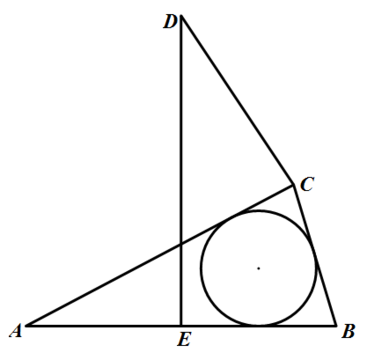

# Mathematics - 题目 1307

**ID**: daf6d798e1144375a3d922573fa1f4b0
**年级**: Grade 12
**难度**: Medium-Hard
**题型**: Multiple-choice

## 题目
如图，在 $\vartriangle ABC$ 中， $\left |{{\rm AB}}\right |=4$ ，点 $E$ 为 $AB$ 的中点，点 $D$ 为线段 $AB$ 垂直平分线上的一点，且 $\left |{DE}\right |=4$ ，固定边 $AB$ ，在平面 $ABD$ 内移动顶点 $C$ ，使得 $\vartriangle ABC$ 的内切圆始终与 $AB$ 切于线段 $BE$ 的中点，且 $C$ 、 $D$ 在直线 $AB$ 的同侧，在移动过程中，当 $\left |{CA}\right |+\left |{CD}\right |$ 取得最小值时， $\vartriangle ABC$ 的面积为（      ）​​​​​​​‌

## 解答

1. 如图，
2. 
3. 以 $AB$ 所在直线为 $x$ 轴， $ED$ 所在直线为 $y$ 轴建立平面直角坐标系，
4. 则 $A\left ({-2,0}\right )$ ， $B\left ({2,0}\right )$ ， $D\left ({0,4}\right )$ ，设 $\vartriangle ABC$ 的内切圆分别切 $BC$ 、 $AC$ 、 $AB$ 于 $F$ ， $G$ ， $H$ 点，
5. ∵ $\left |{CA}\right |-\left |{CB}\right |=\left |{AG}\right |-\left |{BF}\right |=\left |{AH}\right |-\left |{HB}\right |=3-1=2<4$ ，
6. 所以 $C$ 点的轨迹是以 $A$ 、 $B$ 为焦点的双曲线的第一象限部分，且 $a=1$ ， $c=2$ ， $b{^{2}}=c{^{2}}-a{^{2}}=3$ ，
7. ∴ $C$ 的轨迹方程为 $x{^{2}}-\frac {y{^{2}}}{3}>0\left ({x,y>0}\right )$ ．
8. ∵ $\left |{CA}\right |-\left |{CB}\right |=2$ ，∴ $\left |{CA}\right |=\left |{CB}\right |+2$ ，∴ $\left |{CA}\right |+\left |{CD}\right |=\left |{CB}\right |+\left |{CD}\right |+2$ ，
9. 则当点 $C$ 为线段 $BD$ 与双曲线在第一象限的交点时， $\left |{CA}\right |+\left |{CD}\right |$ 最小，
10. 如图所示：
11. 
12. 线段 $BD$ 的方程为 $y=4-2x\left ({0\leqslant x\leqslant 2}\right )$ ，将其代入 $3x{^{2}}-y{^{2}}-3=0$ ，得 $x{^{2}}-16x+19=0$ ，
13. 解得 $x=8+3\sqrt {5}$ （舍去）或 $x=8-3\sqrt {5}$ ，∴ $y=4-2x=6\sqrt {5}-12$ ，
14. ∴ $C\left ({8-3\sqrt {5},6\sqrt {5}-12}\right )$ ．
15. ∴ $\vartriangle ABC$ 的面积为 $\frac {1}{2}\times 4\times \left ({6\sqrt {5}-12}\right )=12\sqrt {5}-24$ ．
16. 故选：A

## 知识点

**中文**:
  - 范围最值问题

**English**:
  - Range and Extrema Problems

---
