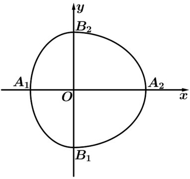

# Mathematics - 题目 1402

**ID**: ed27e9d25b514432a3c04d2e0691b7a2
**年级**: Grade 12
**难度**: Medium-Hard
**题型**: Multiple-choice

## 题目
如图，半椭圆 $\frac {x{^{2}}}{a{^{2}}}+\frac {y{^{2}}}{b{^{2}}}=1(x\geqslant 0)$ 与半椭圆 $\frac {y{^{2}}}{b{^{2}}}+\frac {x{^{2}}}{c{^{2}}}=1(x\leqslant 0)$ 组成的曲线称为“果圆”，其中 $a{^{2}}=b{^{2}}+c{^{2}},a>0,b>c>0$ .​​​​​​​‌ $A{{}_{1}},A{{}_{2}}$ 和 $B{{}_{1}},B{{}_{2}}$ 分别是“果圆”与x轴，y轴的交点.给出下列三个结论：① $\sqrt {2}c<a<\sqrt {2}b$ ；②若 $\left |{A{{}_{1}}A{{}_{2}}}\right |=\left |{B{{}_{1}}B{{}_{2}}}\right |$ ，则 $a:b:c=5:4:3$ ；③若在“果圆”y轴右侧部分上存在点P，使得 $\angle A{{}_{1}}PA{{}_{2}}=90{}\degree $ ，则 $\frac {1}{2}<\frac {c}{a}<\frac {\sqrt {5}-1}{2}$ .其中，所有正确结论的序号是（      ）

## 解答

1. 由题可知 $a>b>c$ ，
2. 所以 $a{^{2}}=b{^{2}}+c{^{2}}>2c{^{2}}$ ， $a>\sqrt {2}c$ ； $a{^{2}}=b{^{2}}+c{^{2}}<2b{^{2}}$ ， $a<\sqrt {2}b$ ，
3. 故①正确；
4. 由 $\left |{A{{}_{1}}A{{}_{2}}}\right |=\left |{B{{}_{1}}B{{}_{2}}}\right |$ 得， $a+c=2b$ ，又 $a{^{2}}=b{^{2}}+c{^{2}}$ ，
5. 得 $a=\frac {5}{4}b$ ， $c=\frac {3}{4}b$ ， $a:b:c=5:4:3$ ，②正确.
6. 以 $A{{}_{1}}A{{}_{2}}$ 为直径的圆 E: $\left ({x+c}\right )\left ({x-a}\right )+y{^{2}}=0$ ，与“果园”右侧有异于 $A{{}_{2}}$ 公共点的公共点，
7. 由方程组 $\begin{cases}\left ({x+c}\right )\left ({x-a}\right )+y{^{2}}=0\\\frac {x{^{2}}}{a{^{2}}}+\frac {y{^{2}}}{b{^{2}}}=1(x\geqslant 0)\end{cases}$ ，得 $\frac {c{^{2}}}{a{^{2}}}x{^{2}}+\left ({c-a}\right )x+a{^{2}}-ac-c{^{2}}=0$
8. 显然方程已有一根 $a$ ，另一根为 $x$ ，则 $ax=\frac {a{^{2}}-ac-c{^{2}}}{\frac {c{^{2}}}{a{^{2}}}}=\frac {a{^{2}}\left ({a{^{2}}-ac-c{^{2}}}\right )}{c{^{2}}}$ ，
9. $x=\frac {a\left ({a{^{2}}-ac-c{^{2}}}\right )}{c{^{2}}}$ ， $0<x<a$ ， $0<\frac {a\left ({a{^{2}}-ac-c{^{2}}}\right )}{c{^{2}}}<a$
10. 解得 $\frac {1}{2}<\frac {c}{a}<\frac {\sqrt {5}-1}{2}$ ，故③正确.
11. 故选:D

## 知识点

**中文**:
  - 圆锥曲线性质综合应用

**English**:
  - Comprehensive Application of Properties

---
