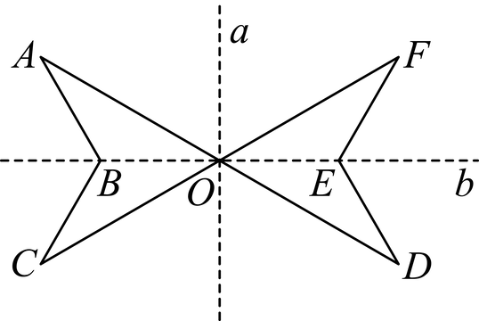

# Mathematics - 题目 1597

**ID**: 043059fe587c4b149853a2490305d236
**年级**: Grade 12
**难度**: Medium-Hard
**题型**: Multiple-select

## 题目
已知某平面图形由如图所示的四个全等的等腰 $\vartriangle ABO,\vartriangle CBO,\vartriangle FEO,\vartriangle DEO$ 拼成，其中线段 $AD,CF,BE$ 的中点均为点 $O$ ，且 $AO=\sqrt {3}BO=2\sqrt {3}$ .​​​​​​​‌若将该平面图形绕着直线 $a$ 旋转半周围成的几何体记为 ${\rm{Ω}}{{}_{1}}$ ，将该平面图形绕着直线 $b$ 旋转半周围成的几何体记为 ${\rm{Ω}}{{}_{2}}$ ，直线 $a\bot $ 直线 $b$ ，则（      ）

## 解答

1. 
2. 过点 $\mathrm{A}$ 作 $AH\bot $ 直线 $a$ ，垂足为 $H$ ，过点 $\mathrm{A}$ 作 $AM\bot $ 直线 $b$ ，垂足为 $M$ .
3. 由题意易得 $∠AOB=\frac {{\rm{π}}}{6},∠AOH=\frac {{\rm{π}}}{3}$ ，所以 $AM=\frac {1}{2}AO=\sqrt {3},AH=\frac {\sqrt {3}}{2}AO=3$ ，
4. 所以该平面图形绕着直线 $a$ 旋转半周，点 $\mathrm{A}$ 的运动轨迹是半径为3的半圆，其长度为 $\frac {1}{2}\times 2{\rm{π}}\times 3=3{\rm{π}}$ ，
5. 该平面图形绕着直线 $b$ 旋转半周，点 $\mathrm{A}$ 的运动轨迹是半径为 $\sqrt {3}$ 的半圆，其长度为 $\frac {1}{2}\times 2{\rm{π}}\times \sqrt {3}=\sqrt {3}{\rm{π}}$ ，
6. 所以经过两次旋转后，点 $\mathrm{A}$ 的运动轨迹总长为 $\left ({3+\sqrt {3}}\right ){\rm{π}}{\rm ，C}$ 错误，D正确.
7. ${\rm{Ω}}{{}_{1}}$ 为两个圆台挖去两个圆锥， ${\rm{Ω}}{{}_{1}}$ 的体积为 $2\left [\frac {1}{3}\left ({4{\rm{π}}+9{\rm{π}}+6{\rm{π}}}\right )\times \sqrt {3}-\frac {1}{3}{\rm{π}}\times 3{^{2}}\times \sqrt {3}\right ]=\frac {20\sqrt {3}}{3}{\rm{π}}{\rm ，A}$ 正确.
8. ${\rm{Ω}}{{}_{2}}$ 为两个大圆锥挖去两个小圆锥，表面积为 $2\left ({{\rm{π}}\times \sqrt {3}\times 2\sqrt {3}+{\rm{π}}\times \sqrt {3}\times 2}\right )=\left ({12+4\sqrt {3}}\right ){\rm{π}}{\rm ，B}$ 错误.
9. 故选AD.

## 知识点

**中文**:
  - 简单组合体的表面积与体积

**English**:
  - Area and Volume of Composite Solids

---
