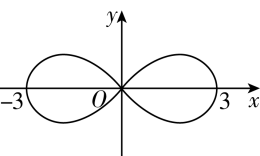

# Mathematics - 题目 3601

**ID**: 0588964738114654827dd42dc8b89d4a
**年级**: Grade 12
**难度**: Medium-Hard
**题型**: Multiple-select

## 题目
双纽线的图形轮廓像阿拉伯数字中的“8”．如图,曲线C: $({\mathit{x}}^{\text{2}}\text{+}{\mathit{y}}^{\text{2}}{)}^{\text{2}}{\rm =\mathit{a}(\mathit{x}^{2}-\mathit{y}^{2})}$ 是双纽线,关于曲线C,下列说法正确的是    	（      ）​​​​​​​‌

## 解答

1. 对于A:由题图可知,点(3,0)在C上,所以a=9,A正确．
2. 对于B:设曲线C上任一点P(x,y),由 $({\mathit{x}}^{\text{2}}\text{+}{\mathit{y}}^{\text{2}}{)}^{\text{2}}{\rm =9(\mathit{x}^{2}-\mathit{y}^{2})}$ ,可得 ${\rm 0\leqslant \mathit{x}^{2}+\mathit{y}^{2}=}\frac{\text{9(}{\mathit{x}}^{\text{2}}\text{-}{\mathit{y}}^{\text{2}})}{{\mathit{x}}^{\text{2}}\text{+}{\mathit{y}}^{\text{2}}}{\rm \leqslant 9}$ ,则 ${\rm 0\leqslant }\sqrt{{\mathit{x}}^{\text{2}}\text{+}{\mathit{y}}^{\text{2}}}{\rm \leqslant 3}$ ,即C上不存在点 ${\rm (\mathit{x}_{0},\mathit{y}_{0})}$ ,使得 $\sqrt{{\mathit{x}}_{\text{0}}^{\text{2}}\text{+}{\mathit{y}}_{\text{0}}^{\text{2}}}$ >3,B不正确．
3. 对于C:方程 $({\mathit{x}}^{\text{2}}\text{+}{\mathit{y}}^{\text{2}}{)}^{\text{2}}{\rm =9(\mathit{x}^{2}-\mathit{y}^{2})}$ 可化为x^{4}+(2y^{2}−9)x^{2}+y^{2}(y^{2}+9)=0,令t=x^{2},得t^{2}+(2y^{2}−9)t+y^{2}(y^{2}+9)=0,由
4. $\left\{\begin{array}{l}\textit{Δ}=\left(2y^2-9\right)^2-4y^2\left(y^2+9\right)=-9\left(8y^2-9\right)\geqslant 0,\\t_1+t_2=-\left(2y^2-9\right)\geqslant 0,\\t_1t_2=y^2\left(y^2+9\right)\geqslant 0,\end{array}\right.$
5. 可得 ${\rm 0\leqslant \mathit{y}^{2}\leqslant }\frac{\text{9}}{\text{8}}$ ,即 ${\rm -}\frac{\text{3}\sqrt{\text{2}}}{\text{4}}{\rm \leqslant \mathit{y}\leqslant }$  $\frac{\text{3}\sqrt{\text{2}}}{\text{4}}$ ,等号成立,故C上的点的纵坐标的最大值为 $\frac{\text{3}\sqrt{\text{2}}}{\text{4}}{\rm ,C}$ 正确．
6. 对于D:直线y=kx与C均经过原点(0,0),则直线y=kx与C除原点外无其他公共点．联立 $\begin{cases}({\mathit{x}}^{\text{2}}\text{+}{\mathit{y}}^{\text{2}}{)}^{\text{2}}\text{=9(}{\mathit{x}}^{\text{2}}\text{-}{\mathit{y}}^{\text{2}}\text{),}\\\mathit{y}\text{=}\mathit{kx},\end{cases}$ 整理得 ${\rm \mathit{x}^{4}}\text{(1+}{\mathit{k}}^{\text{2}}{)}^{\text{2}}{\rm -9\mathit{x}^{2}(1-\mathit{k}^{2})=0}$ ．当1-k^{2}=0时,方程x^{4}=0仅有一解x=0,满足题意．当1-k^{2}≠0时,当x=0时,方程恒成立,即恒有一解;当x≠0时,方程化简得 ${\rm \mathit{x}^{2}=}\frac{\text{9(1-}{\mathit{k}}^{\text{2}})}{\text{(1+}{\mathit{k}}^{\text{2}}{)}^{\text{2}}}$ ,即当1-k^{2}<0时,方程无解,满足题意．综上,1-k^{2}⩽0,解得k⩾1或k⩽−1,D正确．故选ACD．

## 知识点

**中文**:
  - 函数的图象

**English**:
  - Graphs of Functions

---
