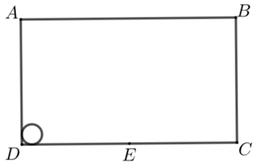

# Mathematics - 题目 117

**ID**: 1510b549d9a34dd19cf61005f9cebd6e
**年级**: Grade 12
**难度**: Medium-Hard
**题型**: Multiple-select

## 题目
台球是一项有趣的体育项目，如图的球桌上在左下角的D点有一颗球（体积忽略不计），现击打该球使其在球桌上做理想运动，碰撞到桌壁后反弹时满足反射角=入射角，设洞口E为CD中点， $\frac {AD}{AB}=λ\left ({0<λ<1}\right )$ ，击球方向与CD所在直线夹角的正切值为 $μ$ ，则下列说法正确的是：（      ）．​​​​​​​‌

## 解答

1. A：当 $λ=\frac {2}{3}$ 时，可设 $AD=8,AB=12$ .击打球使其碰撞 $AB$ 靠近 $\mathrm{A}$ 端的四等分点，反射后再正好进入洞口 $E$ ，所以 $μ=\frac {8}{\frac {12}{4}}=\frac {8}{3}$ ，故A错误；
2. B：当 $λ=\frac {2}{3}$ 时，可设 $AD=8,AB=12$ .第一次碰撞在 $BC$ 边上，所以不可能只碰撞一次进入洞口，假设碰撞两次进入洞口，则第二次碰撞一定在 $AB$ 边上，将桌面依次向右、向上翻折一次， $E$ 到达 $E^{′}$ ，观察线段 $DE^{′}$ ，要求此线段完全在桌面与翻折桌面构成图形的内部，设直线 $k{{}_{DE^{′}}}=\frac {2\times AD}{\frac {3}{2}AB}=\frac {8}{9}$ ，所以 $l{{}_{DE^{′}}}：y=\frac {8}{9}x$ ，令 $y=8$ 得 $x=9<12=AB$ ，所以线段不可能完全在桌面与翻折桌面构成图形的内部，即不可能两次碰撞入洞．如第二张图，计算得： $μ=\frac {8+8}{12+12+6}=\frac {8}{15}$ 时可以碰撞三次入洞（线段 $DE^{′}$ 完全在桌面与翻折桌面构成图形的内部），B正确；
3. C：如第三张图，依次将桌面向上、向右翻折，对应连接 $D、E^{′}$ 得到线段 $DE^{′}$ ，观察线段 $EE^{′}$ ，其经过 $B$ 点，所以 $DE^{′}$ 与直线 $AB$ 的交点 $M$ 在线段 $AB$ 上，故线段 $DE^{′}$ 完全在桌面与翻折桌面构成图形的内部，这意味着这样击球球将依次碰撞桌壁 $AB、BC$ 后进洞，碰撞了两次，C正确．
4. D：如第四张图，同C翻折，同理分析，观察线段 $E^{′}E^{′′}$ ，交点恰好在转折点处，所以线段 $DE^{′}$ 一定不可能完全在桌面与翻折桌面构成图形的内部，D错误．
5. 。
6. 故选BC．

## 知识点

**中文**:
  - 直线方程的实际应用

**English**:
  - Real-world Applications

---
