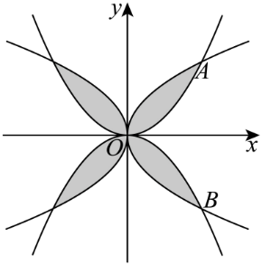

# Mathematics - 题目 1168

**ID**: 22b3cc5f9e9c481fa189c266a1a850b5
**年级**: Grade 12
**难度**: Medium-Hard
**题型**: Multiple-select

## 题目
在 $2024$ 年巴黎奥运会艺术体操项目集体全能决赛中，中国队以 $69.​​​​​​​‌800$ 分的成绩夺得金牌，这是中国艺术体操队在奥运会上获得的第一枚金牌．艺术体操的绳操和带操可以舞出类似四角花瓣的图案，它可看作由抛物线 $C:y{^{2}}=2px\left ({p>0}\right )$ 绕其顶点分别逆时针旋转 $90{^{\circ }}$ 、 $180{^{\circ }}$ 、 $270{^{\circ }}$ 后所得三条曲线与 $C$ 围成的（如图阴影区域）， $\mathrm{A}$ 、 $B$ 为 $C$ 与其中两条曲线的交点，若 $p=2$ ，则（      ）

## 解答

1. 对于A，由题意，开口向右的抛物线方程为 $C:y{^{2}}=4x$ ，顶点在原点，焦点为 $F{{}_{1}}\left ({1,0}\right )$ ,
2. 将其逆时针旋转 $90{^{\circ }}$ 后得到的抛物线开口向上，焦点为 $F{{}_{2}}\left ({0,1}\right )$ ，则其方程为 $x{^{2}}=4y$ ，
3. 即 $y=\frac {1}{4}x{^{2}}$ ，故A错误；
4. 对于B，根据A项分析，由 $\begin{cases}y{^{2}}=4x\\x{^{2}}=4y\end{cases}$ 可解得 $x=0$ 或 $x=4$ ，即 $x{{}_{A}}=4$ ，
5. 代入可得 $y{{}_{A}}=4$ ，
6. 由图象的对称性，可得 $A\left ({4,4}\right )$ 、 $B\left ({4,-4}\right )$ ，故 $\left |{AB}\right |=8$ ，即B正确；
7. 对于C，
8. 
9. 设直线 $y=x+m{{}_{1}}$ 与抛物线 $y{^{2}}=4x$ 相切，联立 $\begin{cases}y=x+m{{}_{1}}\\y{^{2}}=4x\end{cases}$ 可得 $y{^{2}}-4y+4m{{}_{1}}=0$ ，
10. 由 $Δ=16-16m{{}_{1}}=0$ 可得 $m{{}_{1}}=1$ ，且方程 $y{^{2}}-4y+4m{{}_{1}}=0$ 即为 $y{^{2}}-4y+4=0$ ，
11. 解得 $y=2$ ， $x=1$ ，此时，切点坐标为 $\left ({1,2}\right )$ ，
12. 设直线 $y=x+m{{}_{2}}$ 与抛物线 $x{^{2}}=4y$ 相切，联立 $\begin{cases}y=x+m{{}_{2}}\\x{^{2}}=4y\end{cases}$ 可得 $x{^{2}}-4x-4m{{}_{2}}=0$ ，
13. 由 $Δ=16+16m{{}_{2}}=0$ 可得 $m{{}_{2}}=-1$ ，此时方程 $x{^{2}}-4x-4m{{}_{2}}=0$ 即为 $x{^{2}}-4x+4=0$ ，
14. 解得 $x=2$ ， $y=1$ ，此时，切点坐标为 $(2,1)$ ，
15. 两切点连线的斜率为 $\frac {1-2}{2-1}=-1$ ，即切点的连线与直线 $x+y=t$ 垂直，
16. 故当 $M\left ({1,2}\right )$ 、 $N\left ({2,1}\right )$ 时， $\left |{MN}\right |$ 取最大值，
17. 且其最大值为 $\left |{MN}\right |=\sqrt {{\left({1-2}\right)^{2}}+{\left({2-1}\right)^{2}}}=\sqrt {2}{\rm ，C}$ 正确；
18. 对于D，根据对称性，每个象限的花瓣形状大小相同，故可以先求 $\frac {1}{8}$ 部分面积的近似值，
19. 如图，
20. 
21. 对函数 $y=\frac {1}{4}x{^{2}}$ 求导得 $y^{′}\mathrm{=}\frac {1}{2}x$ ，则抛物线 $y=\frac {1}{4}x{^{2}}$ 在点 $A\left ({4,4}\right )$ 处的切线斜率为 $\frac {1}{2}\times 4=2$ ，
22. 所以抛物线 $y=\frac {1}{4}x{^{2}}$ 在点 $\mathrm{A}$ 处的切线方程为 $y-4=2\left ({x-4}\right )$ ，即 $y=2x-4$ ，
23. 该切线交 $x$ 轴于点 $E\left ({2,0}\right )$ ，
24. 所以半个花瓣的面积必小于 $S{{}_{△AOE}}=\frac {1}{2}\times 2\times 4=4$ ，
25. 故原图中的阴影部分面积必小于 $8S{{}_{△AOE}}=8\times 4=32$ ，故D正确.
26. 故选BCD.

## 知识点

**中文**:
  - 抛物线标准方程、焦点坐标和准线方程
  - 抛物线的实际应用
  - 直线与抛物线的位置关系

**English**:
  - Standard Equation, Focus, and Directrix
  - Real-world Applications
  - Line-Parabola Relationship

---
