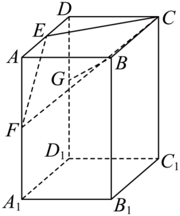

# Mathematics - 题目 1116

**ID**: 28748deb92e04c33b290f473a4fa1be1
**年级**: Grade 12
**难度**: Medium-Hard
**题型**: Multiple-select

## 题目
如图，在长方体 $ABCD-A{{}_{1}}B{{}_{1}}C{{}_{1}}D{{}_{1}}$ 中， $AB=AD=4,AA{{}_{1}}=6,E$ ， $F$ 分别是棱 $AD,AA{{}_{1}}$ 的中点，点 $G$ 在棱 $DD{{}_{1}}$ 上，则下列说法正确的是（      ）​​​​​​​‌

## 解答

1. 以 $D{{}_{1}}$ 为原点， $\overrightarrow {{D{{}_{1}}A{{}_{1}}}},\overrightarrow {{D{{}_{1}}C{{}_{1}}}},\overrightarrow {{D{{}_{1}}D}}$ 的方向分别为 $x,y,z$ 轴的正方向，建立如图所示的空间直角坐标系．
2. 
3. 设 $D{{}_{1}}G=a\left ({0\leqslant a\leqslant 6}\right )$ ，则 $B\left ({4,4,6}\right ),C\left ({0,4,6}\right ),E\left ({2,0,6}\right ),F\left ({4,0,3}\right ),G(0,0,a)$ ，
4. 所以 $\overrightarrow {{EF}}=\left ({2,0,-3}\right ),\overrightarrow {{CF}}=\left ({4,-4,-3}\right ),\overrightarrow {{BG}}=(-4,-4,a-6),\overrightarrow {{CB}}=\left ({4,0,0}\right )$ ．
5. 由 $EF\bot BG$ ，得 $\overrightarrow {{EF}}\cdot \overrightarrow {{BG}}=2\times \left ({-4}\right )+0-3\times \left ({a-6}\right )=0$ ，解得 $a=\frac {10}{3}\in \left [0,6\right ]$ ，故A正确．
6. 设平面 $CEF$ 的法向量为 $\overrightarrow n=\left ({x,y,z}\right )$ ，
7. 则 $\begin{cases}\overrightarrow n\cdot \overrightarrow {{EF}}=2x-3z=0，\\\overrightarrow n\cdot \overrightarrow {{CF}}=4x-4y-3z=0，\end{cases}$ 令 $x=6$ ，得 $\overrightarrow n=\left ({6,3,4}\right )$ ，
8. 所以点 $B$ 到平面 $CEF$ 的距离是 $\frac {\left |{\overrightarrow {{CB}}\cdot \overrightarrow n}\right |}{\left |{\overrightarrow n}\right |}=\frac {24\sqrt {61}}{61}$ ，故B正确．
9. 当 $BG\bot $ 平面 $CEF$ 时， $\overrightarrow {{BG}}/\mskip-4mu/\overrightarrow {{n}}$ ，所以 $\overrightarrow {{n}}=k\overrightarrow {{BG}}$ ，即 $\begin{cases}-4k=6，\\-4k=3，\\\left ({a-6}\right )k=4，\end{cases}$ 此方程组无解，故C错误．
10. 设该长方体外接球的球心为 $O$ ，则 $O\left ({2,2,3}\right )$ ，所以 $\overrightarrow {{CO}}=\left ({2,-2,-3}\right )$ ，
11. 所以点 $O$ 到直线 $CF$ 的距离 $d=\sqrt {\overrightarrow {{CO}}{^{2}}-{\left({\frac {\overrightarrow {{CO}}\cdot \overrightarrow {{CF}}}{\left |{\overrightarrow {{CF}}}\right |}}\right)^{2}}}$ ．
12. 设该截面圆的半径为 $r$ ，则 $\left ({r{^{2}}}\right ){{}_{{\rm{m}}{\rm{i}}{\rm{n}}}}=\overrightarrow {{CO}}{^{2}}-d{^{2}}={\left({\frac {\overrightarrow {{CO}}\cdot \overrightarrow {{CF}}}{\left |{\overrightarrow {{CF}}}\right |}}\right)^{2}}=\frac {625}{41}$ ，
13. 所以所得截面面积的最小值是 ${\rm{π}}\left ({r{^{2}}}\right ){{}_{{\rm{m}}{\rm{i}}{\rm{n}}}}=\frac {625{\rm{π}}}{41}$ ，故D正确．
14. 故选ABD.

## 知识点

**中文**:
  - 向量法求距离-点面距离
  - 截面问题
  - 用向量证明垂直问题

**English**:
  - Point-Plane Distance
  - Cross-section Problems
  - Proving Perpendicularity

---
