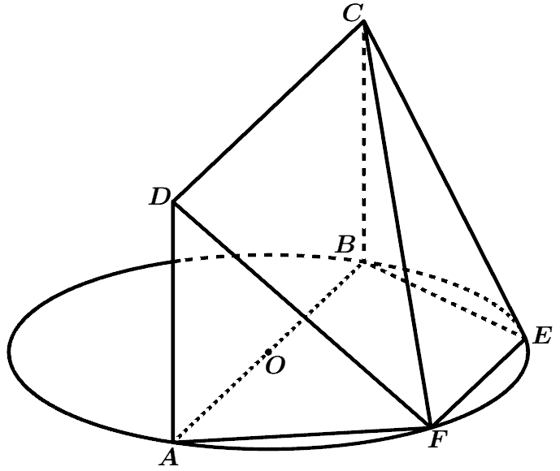

# Mathematics - 题目 2526

**ID**: 36558922cc9640d6ac3bb7647ed4f44e
**年级**: Grade 12
**难度**: Medium-Hard
**题型**: Multiple-select

## 题目
线段AB为圆O的直径，点E，F在圆O上，AB//EF，矩形ABCD所在平面和圆O所在平面垂直，且 $AB=2,AD=EF=1$ .​​​​​​​‌则（      ）

## 解答

1. 对A项，因为 $AB{\rm{/}}{\rm{/}}EF$ ， $AB{\rm{/}}{\rm{/}}CD$ ，所以四边形 $CDEF$ 确定一个平面
2. 由于 $DC,EF$ 长度不相等，则 $DF,CE$ 不平行，即 $DF$ 与平面 $BCE$ 有公共点，故A错误；
3. 对B项，连接 $OF,OE$ ， $OE$ 交 $BF$ 于点 $G$
4. 因为 $OB{\rm{/}}{\rm{/}}EF,OB=EF$ ， $OB=OF=1$ ，所以四边形 $OBEF$ 为菱形
5. 则 $BE=OF=1$ ，所以 $\mathrm{△}OBE$ 为等边三角形
6. 由于点 $G$ 为 $OE$ 的中点，则 $\angle OBG=\frac {1}{2}\angle OBE=30{}^\circ $
7. 因为 $AB{\rm{/}}{\rm{/}}CD$ ，所以异面直线BF与DC所成的角为 $\angle ABF=\angle OBG=30{}^\circ $ ，故B正确；
8. 
9. 对C项，由于四边形 $OBEF$ 为菱形，则 $BF=2BG=2\sqrt {1{^{2}}-{\left({\frac {1}{2}}\right)^{2}}}=\sqrt {3}$
10. 由面面垂直的性质以及线面垂直的性质可知， $BC\bot BE,BC\bot BF$
11. 所以 $CF=\sqrt {1{^{2}}+{\left({\sqrt {3}}\right)^{2}}}=2,CE=\sqrt {1{^{2}}+1{^{2}}}=\sqrt {2}$
12. 又 $EF{^{2}}+CE{^{2}}=3\ne CF{^{2}}$ ，所以 $\vartriangle EFC$ 不是直角三角形，故C错误；
13. 对D项，因为 $BF=\sqrt {3}$ ， $BE=1$ ， $EF=1$ ，所以 $S{{}_{\Delta BEF}}=\frac {1}{2}\times \sqrt {3}\times \sqrt {1{^{2}}-{\left({\frac {\sqrt {3}}{2}}\right)^{2}}}=\frac {\sqrt {3}}{4}$
14. 由面面垂直的性质可知， $BC\mathrm{⊥}$ 平面 $BEF$ ，所以 $V{{}_{C-BEF}}=\frac {1}{3}\times \frac {\sqrt {3}}{4}\times 1=\frac {\sqrt {3}}{12}$
15. 过点 $F$ 作 $AB$ 的垂线，垂足为 $H$ ，则 $FH=\frac {1}{2}BF=\frac {\sqrt {3}}{2}$
16. 根据面面垂直的性质可知 $HF\bot $ 平面 $ABCD$
17. 则 $V{{}_{F-ABCD}}=\frac {1}{3}\times 2\times 1\times \frac {\sqrt {3}}{2}=\frac {\sqrt {3}}{3}$
18. 即 $V{{}_{C-BEF}}{\rm{:}}V{{}_{F-ABCD}}=1{\rm{:}}4$ ，故D正确；
19. 
20. 故选：BD

## 知识点

**中文**:
  - 平面与平面垂直的性质
  - 棱柱、棱锥、棱台的体积
  - 直线与平面平行的判定
  - 异面直线所成角

**English**:
  - Properties of Plane-Plane Perpendicularity
  - Volume of Polyhedra
  - Line-Plane Parallelism Determination
  - Angle between Skew Lines

---
