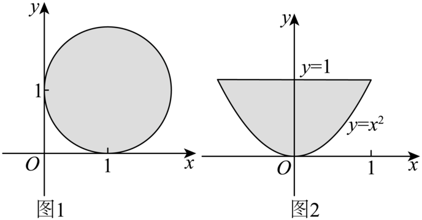

# Mathematics - 题目 1316

**ID**: 431078bcbe2a4b44ae780b6216e8470d
**年级**: Grade 12
**难度**: Medium-Hard
**题型**: Multiple-select

## 题目
几何体的体积可以看成面积的积累，因此可以得到：“夹在两个平行平面之间的两个几何体，被平行于这两个平面的任意平面所截，如果截得的两个截面的面积总相等，则两个几何体体积相等”.​​​​​​​‌旋转体体积也可看作平面区域面积绕与其不相交的轴（可为其边界）旋转的积累，因每个点旋转的周长不一致，平面区域旋转的长度可用该区域的重心旋转长度替代，于是可得到旋转体体积计算方法：旋转体体积=旋转区域面积 $\times $ 重心旋转的圆形轨迹周长.如图1，记圆面 ${\left({x-1}\right)^{2}}+{\left({y-1}\right)^{2}}\leqslant 1$ 绕 $x$ 轴旋转形成的几何体体积为 $V{{}_{1}}$ ，记半圆面 ${\left({x-1}\right)^{2}}+{\left({y-1}\right)^{2}}\leqslant 1\left ({y\leqslant 1}\right )$ 重心坐标为 $\left ({x{{}_{0}},y{{}_{0}}}\right )$ .如图2，阴影部分为函数 $y=x{^{2}}$ 与 $y=1$ 围成的区域，记该区域绕 $x$ 轴， $y$ 轴旋转形成的几何体体积分别为 $V{{}_{2}}$ ， $V{{}_{3}}$ .则（      ）

## 解答

1. 对于A，易知它的重心即其圆心，由定义可知 $V{{}_{1}}={\rm{π}}\times 1{^{2}}\times 2{\rm{π}}\times 1=2{\rm{π}}{^{2}}$ ，故A错误；
2. 对于B，易知该半圆面绕 $y=1$ 旋转所得的几何体为半径为1的球体，
3. 其体积 $V=\frac {4}{3}{\rm{π}}\times {{1}}{^{3}}=\frac {1}{2}{\rm{π}}\times 1{^{2}}\times 2{\rm{π}}\left ({1-y{{}_{0}}}\right )\Rightarrow y{{}_{0}}=1-\frac {4}{3{\rm{π}}}$ ，故B正确；
4. 对于C，根据条件易知半圆面 ${\left({x-1}\right)^{2}}+{\left({y-1}\right)^{2}}\leqslant 1\left ({y\leqslant 1}\right )$ 绕横轴旋转形成的几何体体积为
5. $V^{′}=\frac {{\rm{π}}}{2}\times 1{^{2}}\times 2{\rm{π}}y{{}_{0}}={\rm{π}}{^{2}}-\frac {4}{3}{\rm{π}}$ ，
6. 设点 $P\left ({x{{}_{0}},x{{}_{0}^{2}}}\right )\left ({-1\leqslant x{{}_{0}}\leqslant 1}\right ),A\left ({0,1}\right )$ ，
7. 则 $\left |{AP}\right |{^{2}}=x{{}_{0}^{2}}+{\left({x{{}_{0}^{2}}-1}\right)^{2}}={\left({x{{}_{0}^{2}}-\frac {1}{2}}\right)^{2}}+\frac {3}{4}\in \left [\frac {3}{4},1\right ]$ ，
8. 所以图2阴影面积小于半径为1的半圆面积，即 $V{{}_{2}}<V^{′}$ ，故C正确；
9. 对于D，图（1）阴影区域满足 $\begin{cases}x{^{2}}\geqslant y\\-1\leqslant x\leqslant 1\\y\geqslant 0\end{cases}$ ，其绕纵轴旋转形成的几何体体积记为 $V{{}_{4}}$ ，
10. 图（2）阴影区域满足 $\begin{cases}x{^{2}}+y{^{2}}\leqslant 1\\x{^{2}}+{\left({y-\frac {1}{2}}\right)^{2}}\geqslant \frac {1}{4}\\y\geqslant 0\end{cases}$ ，其绕纵轴旋转形成的几何体体积记为 $V{{}_{5}}$ ，
11. 设纵坐标为 $h\left ({h\in \left [0,1\right ]}\right )$ 的平面去截这两个几何体，
12. 联立 $\begin{cases}y=h\\y=x{^{2}}\end{cases}$ 得 $x{{}_{1}}=\pm \sqrt {h}$ ，其截图（1）对应旋转体的截面面积为
13. $S{{}_{1}}={\rm{π}}\times 1{^{2}}-{\rm{π}}\times {\left({\sqrt {h}}\right)^{2}}=\left ({1-h}\right ){\rm{π}}$ ，
14. 联立 $\begin{cases}y=h\\x{^{2}}+y{^{2}}=1\\x{^{2}}+{\left({y-\frac {1}{2}}\right)^{2}}=\frac {1}{4}\end{cases}$ 得 $\begin{cases}x{{}_{2}}=\pm \sqrt {1-h{^{2}}}\\x{{}_{3}}=\pm \sqrt {h-h{^{2}}}\end{cases}$ ，其截图（2）对应旋转体的截面面积为
15. $S{{}_{2}}={\rm{π}}\times {\left({\sqrt {1-h{^{2}}}}\right)^{2}}-{\rm{π}}\times {\left({\sqrt {h-h{^{2}}}}\right)^{2}}=\left ({1-h}\right ){\rm{π}}$ ，则 $V{{}_{4}}=V{{}_{5}}$ ，
16. 易知 $V{{}_{5}}=\frac {1}{2}\times \frac {4}{3}{\rm{π}}\times 1{^{3}}-\frac {4}{3}{\rm{π}}\times {\left({\frac {1}{2}}\right)^{3}}=\frac {{\rm{π}}}{2}$ ，而 $V{{}_{2}}={\rm{π}}\times 1{^{2}}\times 1-V{{}_{4}}={\rm{π}}-\frac {{\rm{π}}}{2}=\frac {{\rm{π}}}{2}$ ，故D正确；
17. 
18. 故选BCD.

## 知识点

**中文**:
  - 球的体积
  - 简单组合体的表面积与体积

**English**:
  - Volume of a Sphere
  - Area and Volume of Composite Solids

---
