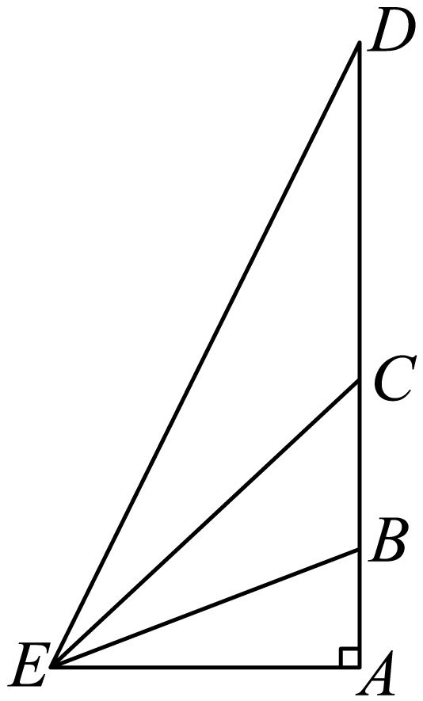

# Mathematics - 题目 2657

**ID**: 4968fc3192a844aca24ce8527df4c259
**年级**: Grade 12
**难度**: Medium-Hard
**题型**: Multiple-select

## 题目
如图，直角 $\vartriangle EAD$ 中 $\mathrm{A}$ 为直角顶点， $∠AED$ 的三等分线和 $AD$ 相交，交点离 $\mathrm{A}$ 较近的是 $B$ ，较远的是 $C$ .​​​​​​​‌设 $\angle AED=3θ$ ， $EA=1$ ，则（      ）

## 解答

1. 由题意可得
2. $AB={\rm{t}}{\rm{a}}{\rm{n}}θ$ ， $BC={\rm{t}}{\rm{a}}{\rm{n}}2θ-{\rm{t}}{\rm{a}}{\rm{n}}θ$ ， $CD={\rm{t}}{\rm{a}}{\rm{n}}3θ-{\rm{t}}{\rm{a}}{\rm{n}}2θ$
3. 由条件可知 $0<θ<\frac {{\rm{π}}}{6}$ ，令 ${\rm{t}}{\rm{a}}{\rm{n}}θ=t$ ，则 $0<t<\frac {\sqrt {3}}{3}$ .
4. 利用二倍角公式，可得 ${\rm{t}}{\rm{a}}{\rm{n}}2θ=\frac {2t}{1-t{^{2}}}$ ， ${\rm{t}}{\rm{a}}{\rm{n}}3θ=\frac {{\rm{t}}{\rm{a}}{\rm{n}}θ+{\rm{t}}{\rm{a}}{\rm{n}}2θ}{1-{\rm{t}}{\rm{a}}{\rm{n}}θ{\rm{t}}{\rm{a}}{\rm{n}}2θ}=\frac {t+\frac {2t}{1-t{^{2}}}}{1-t\frac {2t}{1-t{^{2}}}}=\frac {3t-t{^{3}}}{1-3t{^{2}}}$ .
5. 由此可得 $AB+CD-2BC={\rm{t}}{\rm{a}}{\rm{n}}3θ-3{\rm{t}}{\rm{a}}{\rm{n}}2θ+3{\rm{t}}{\rm{a}}{\rm{n}}θ$
6. $=\frac {3t-t{^{3}}}{1-3t{^{2}}}-\frac {6t}{1-t{^{2}}}+3t$
7. $=\frac {\left ({3t-t{^{3}}}\right )\left ({1-t{^{2}}}\right )-6t\left ({1-3t{^{2}}}\right )+3t\left ({1-3t{^{2}}}\right )\left ({1-t{^{2}}}\right )}{\left ({1-3t{^{2}}}\right )\left ({1-t{^{2}}}\right )}$
8. $=\frac {2t{^{3}}\left ({1+5t{^{2}}}\right )}{\left ({1-3t{^{2}}}\right )\left ({1-t{^{2}}}\right )}$
9. 显然上式不等于0，故选项B正确，选项A错误.
10. $AB\cdot CD-BC{^{2}}={\rm{t}}{\rm{a}}{\rm{n}}θ\left ({{\rm{t}}{\rm{a}}{\rm{n}}3θ-{\rm{t}}{\rm{a}}{\rm{n}}2θ}\right )-{\left({{\rm{t}}{\rm{a}}{\rm{n}}2θ-{\rm{t}}{\rm{a}}{\rm{n}}θ}\right)^{2}}$
11. $=t\left ({\frac {3t-t{^{3}}}{1-3t{^{2}}}-\frac {2t}{1-t{^{2}}}}\right )-{\left({\frac {2t}{1-t{^{2}}}-t}\right)^{2}}$
12. $=t{^{2}}\left ({\frac {3-t{^{2}}}{1-3t{^{2}}}-\frac {2}{1-t{^{2}}}}\right )-t{^{2}}{\left({\frac {2}{1-t{^{2}}}-1}\right)^{2}}$
13. $=\frac {t{^{2}}{\left({t{^{2}}+1}\right)^{2}}}{\left ({1-3t{^{2}}}\right )\left ({1-t{^{2}}}\right )}-\frac {t{^{2}}{\left({t{^{2}}+1}\right)^{2}}}{{\left({1-t{^{2}}}\right)^{2}}}$
14. $=\frac {t{^{2}}{\left({t{^{2}}+1}\right)^{2}}}{1-t{^{2}}}\left ({\frac {1}{1-3t{^{2}}}-\frac {1}{1-t{^{2}}}}\right )$
15. $=\frac {2t{^{4}}{\left({t{^{2}}+1}\right)^{2}}}{{\left({1-t{^{2}}}\right)^{2}}\left ({1-3t{^{2}}}\right )}.$
16. 显然上式不等于0，故选项D正确，选项C错误.
17. 故选BD.

## 知识点

**中文**:
  - 两角和与差的正切公式
  - 二倍角的正切
  - 等差数列的判定与证明
  - 等比数列的判定与证明

**English**:
  - Tangent of Sum and Difference
  - Double Angle Tangent
  - Determination and Proof
  - Determination and Proof

---
