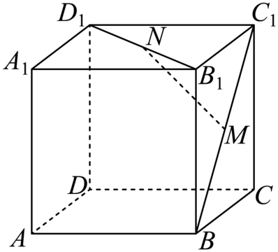

# Mathematics - 题目 1236

**ID**: 55dbf7b6dea24c238a2b1a45bcf2efe9
**年级**: Grade 12
**难度**: Medium-Hard
**题型**: Multiple-select

## 题目
正方体 $ABCD-A{{}_{1}}B{{}_{1}}C{{}_{1}}D{{}_{1}}$ 的棱长为2，M，N分别为线段 $BC{{}_{1}},B{{}_{1}}D{{}_{1}}$ 上的动点(包含端点)，则（      ）​​​​​​​‌

## 解答

1. 选项A:当 $M$ 和 $B$ 重合， $N$ 和 $D{{}_{1}}$ 重合时，
2. MN与 $A{{}_{1}}C$ 相交，故A错误；
3. 选项B:当 $N$ 为线段 $B{{}_{1}}D{{}_{1}}$ 中点时，
4. 
5. 由正方体得 $C{{}_{1}}N/\mskip-4mu/AC$ ，因为 $C{{}_{1}}N/\mskip-4mu/AC,BC{{}_{1}}/\mskip-4mu/AD{{}_{1}},C{{}_{1}}N\mathrm{∩}BC{{}_{1}}=C{{}_{1}},AC\mathrm{∩}AD{{}_{1}}=A,BC{{}_{1}},C{{}_{1}}N\subset $ 平面 $BC{{}_{1}}N$ , $AC,AD{{}_{1}}\subset $ 平面 $ACD{{}_{1}}$ ，
6. 所以平面 $BC{{}_{1}}N/\mskip-4mu/$ 平面 $ACD{{}_{1}}$ ，
7. 而 $MN\subset $ 平面 $BC{{}_{1}}N$ ，
8. 则 $MN/\mskip-4mu/$ 平面 $ACD{{}_{1}}$ ，故B正确；
9. 选项C:当 $\frac {\left |{BM}\right |}{\left |{MC{{}_{1}}}\right |}=\frac {\left |{D{{}_{1}}N}\right |}{\left |{NB{{}_{1}}}\right |}=2$ 时，延长 $A{{}_{1}}N,CM$ 交 $B{{}_{1}}C{{}_{1}}$ 中点 $E$ ，
10. 由相似成比例可知: $\frac {\left |{CM}\right |}{\left |{ME}\right |}=\frac {\left |{A{{}_{1}}N}\right |}{\left |{NE}\right |}=2$ ，
11. 故 $MN/\mskip-4mu/A{{}_{1}}C$ ，以 $D$ 点为原点建立如图所示的空间直角坐标系，
12. 
13. 所以 $A{{}_{1}}(2,0,2)$ ， $C(0,2,0)$ ， $B(2,2,0)$ ， $C{{}_{1}}(0,2,2)$ ，
14. 所以 $\overrightarrow {{A{{}_{1}}C}}=(-2,2,-2)$ ， $\overrightarrow {{DB}}=(2,2,0)$ ， $\overrightarrow {{DC{{}_{1}}}}=(0,2,2)$ ，
15. 设面 $BC{{}_{1}}D$ 法向量 $\overrightarrow m=(x,y,z)$ ，
16. 所以 $\begin{cases}2x+2y=0\\2y+2z=0\end{cases}$ ，令 $x=1$ ，则 $\overrightarrow m=(1,-1,1)$ ，
17. 因为 $\overrightarrow {{A{{}_{1}}C}}=-2\overrightarrow m$ ，所以 $A{{}_{1}}C\bot $ 平面 $BC{{}_{1}}D$ ，
18. 可知直线 $MN\bot $ 平面 $BC{{}_{1}}D$ ，故C正确；
19. 
20. 选项D:由选项 ${\rm{C}}$ 可知，当 $\frac {\left |{BM}\right |}{\left |{MC{{}_{1}}}\right |}=\frac {\left |{D{{}_{1}}N}\right |}{\left |{NB{{}_{1}}}\right |}=2$ 时，MN为直线 $B{{}_{1}}D{{}_{1}}$ 与 $BC{{}_{1}}$ 公垂线段，
21. 故|MN|最小值为 $\frac {1}{3}\left |{A{{}_{1}}C}\right |=\frac {2\sqrt {3}}{3}$ ，最大值为 $\left |{BD{{}_{1}}}\right |=2\sqrt {3}$ ，故D正确.
22. 故选：BCD.

## 知识点

**中文**:
  - 动点问题
  - 直线与直线的位置关系的判断
  - 直线与平面平行的判定
  - 用向量证明垂直问题

**English**:
  - Moving Point Problems
  - Determining Line-Line Relationships
  - Line-Plane Parallelism Determination
  - Proving Perpendicularity

---
