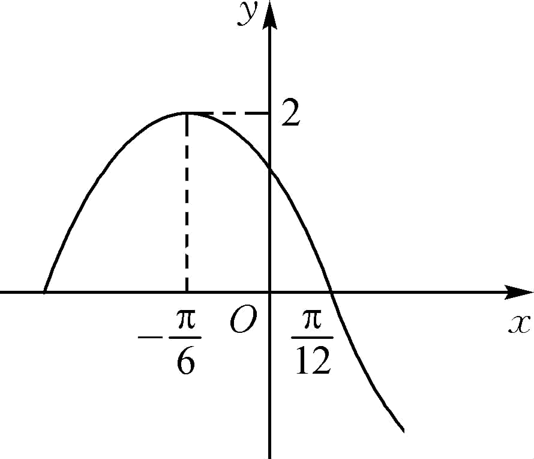

# Mathematics - 题目 2000

**ID**: 6422ca32cd844b0481d4613257e28d6c
**年级**: Grade 12
**难度**: Medium-Hard
**题型**: Multiple-select

## 题目
函数 $f\left ({x}\right )=A{\rm{c}}{\rm{o}}{\rm{s}}\left ({ωx+φ}\right )\left ({A>0,ω>0,\left |{φ}\right |<\frac {π}{2}}\right )$ 的部分图象如图所示，则（      ）​​​​​​​‌

## 解答

1. 解：由图可知 $A=2$ ， $\frac {T}{4}=\frac {π}{12}-\left ({-\frac {π}{6}}\right )=\frac {π}{4}$ ，所以 $T=π$ ，又 $T=\frac {2π}{ω}$ ，所以 $ω=2$ ，所以 $f\left ({x}\right )=2{\rm{c}}{\rm{o}}{\rm{s}}\left ({2x+φ}\right )$ ，
2. 又 $f\left ({-\frac {π}{6}}\right )=2{\rm{c}}{\rm{o}}{\rm{s}}\left ({-\frac {π}{3}+φ}\right )=2$ ，且 $\left |{φ}\right |<\frac {π}{2}$ ，所以 $φ=\frac {π}{3}$ ，所以 $f\left ({x}\right )=2{\rm{c}}{\rm{o}}{\rm{s}}\left ({2x+\frac {π}{3}}\right )$ ；
3. 对于A：因为 $-2\leqslant f\left ({x}\right )\leqslant 2$ ，所以 $\forall x{{}_{1}},x{{}_{2}}\in {\mathbf{R}}$ ， $\left |{f\left ({x{{}_{1}}}\right )-f\left ({x{{}_{2}}}\right )}\right |\leqslant 4$ ，所以 $M\geqslant 4$ ，故A正确；
4. 对于B：若 $f\left ({x{{}_{1}}}\right )=f\left ({x{{}_{2}}}\right )$ ，即 $2{\rm{c}}{\rm{o}}{\rm{s}}\left ({2x{{}_{1}}+\frac {π}{3}}\right )=2{\rm{c}}{\rm{o}}{\rm{s}}\left ({2x{{}_{2}}+\frac {π}{3}}\right )$ ，
5. 所以 $2x{{}_{1}}+\frac {π}{3}=2x{{}_{2}}+\frac {π}{3}+2kπ$ 或 $2x{{}_{1}}+\frac {π}{3}=-\left ({2x{{}_{2}}+\frac {π}{3}}\right )+2kπ$ ， $k\in \mathbf{Z}$ ，
6. 即 $x{{}_{1}}=x{{}_{2}}+kπ$ 或 $x{{}_{1}}+x{{}_{2}}=kπ-\frac {π}{3}$ ， $k\in \mathbf{Z}$ ，故B错误；
7. 对于C：因为 $f\left ({x}\right )$ 关于 $\left ({\frac {π}{12},0}\right )$ 对称，又 $x{{}_{1}}+x{{}_{2}}=\frac {π}{6}$ ，即 $\frac {x{{}_{1}}+x{{}_{2}}}{2}=\frac {π}{12}$ ，所以 $x=x{{}_{1}}$ 和 $x=x{{}_{2}}$ 关于 $x=\frac {π}{12}$ 对称，
8. 故 $f(x{{}_{1}})=-f(x{{}_{2}})$ ，所以 $f\left ({x{{}_{1}}}\right )+f\left ({x{{}_{2}}}\right )=0$ ，故C正确；
9. 对于D：因为 $x{{}_{1}},x{{}_{2}}\in \left ({\frac {π}{12},\frac {7}{12}π}\right )$ 且 $f(x{{}_{1}})=f(x{{}_{2}})(x{{}_{1}}\ne x{{}_{2}})$ ，由 $f(x)$ 在区间 $\left ({\frac {π}{12},\frac {7}{12}π}\right )$ 内的对称轴为 $x=\frac {π}{3}$ 可知，
10. $x{{}_{1}}+x{{}_{2}}=\frac {2π}{3}$ ，所以 $f(x{{}_{1}}+x{{}_{2}})=f\left ({\frac {2π}{3}}\right )=2{\cos}\left ({2\times \frac {2π}{3}+\frac {π}{3}}\right )=2{\cos}\frac {π}{3}=1$ ，故D正确；
11. 故选：ACD

## 知识点

**中文**:
  - 三角函数的图象和性质的综合应用

**English**:
  - Comprehensive Application of Graphs and Properties

---
