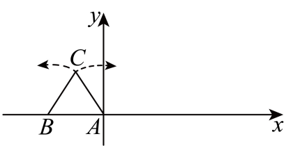

# Mathematics - 题目 3312

**ID**: 73188eef680c4feab2c4cee5db4ae0bd
**年级**: Grade 12
**难度**: Medium-Hard
**题型**: Multiple-select

## 题目
如图，在平面直角坐标系中，边长为2的正三角形 $ABC$ ，沿着 $x$ 轴连续滚动（滚动时无滑动），若滚动中，顶点 $\mathrm{A}$ 恰好经过坐标原点，设顶点 $B\left ({x,y}\right )$ 满足 $y=f\left ({x}\right )$ ，则下列判断正确的有（      ）​​​​​​​‌

## 解答

1. 如图， $B$ 在图中一段一段的扇形上运动，
2. 
3. 对于A，初始时 $A$ 在原点，当 $x=1$ 时， $y=\sqrt {3}$ 即为正三角形的高，故A正确；
4. 对于 ${\rm B，}f\left ({x}\right )$ 的一条对称轴为 $x=1$ ，周期为6，每经过半个周期均为 $f\left ({x}\right )$ 的对称轴，
5. 所以函数 $f\left ({x}\right )$ 的对称轴方程为 $x=1+3k,k\in {\mathbf{Z}}$ ，故B正确；
6. 对于C，函数 $f\left ({x}\right )$ 的单调增区间为 $\left [-2+6k,6k\right ],\left [1+6k,2+6k\right ],k\in {\mathbf{Z}}$ ，故C错误；
7. 对于D，当 $k>0$ 时，直线 $y=kx$ 与圆 ${\left({x-6}\right)^{2}}+y{^{2}}=4$ 相切，此时 $\frac {\left |{6k}\right |}{\sqrt {k{^{2}}+1}}=2\Rightarrow k=\frac {\sqrt {2}}{4}$ ；
8. 当直线 $y=kx$ 与圆 ${\left({x-8}\right)^{2}}+y{^{2}}=4$ 相切，此时 $\frac {\left |{8k}\right |}{\sqrt {k{^{2}}+1}}=2\Rightarrow k=\frac {\sqrt {15}}{15}$ ，经检验切点恰在所在圆弧上， $B{{}_{3}}\left ({7,\sqrt {3}}\right )$ ， $k{{}_{OB{{}_{3}}}}=\frac {\sqrt {3}}{7}$ ；
9. 当 $y=kx$ 与圆 ${\left({x-12}\right)^{2}}+y{^{2}}=4$ 相切时，可得 $\frac {\left |{12k}\right |}{\sqrt {k{^{2}}+1}}=2\Rightarrow k=\frac {\sqrt {35}}{35}$ .
10. 结合图象要使 $y=f\left ({x}\right )$ 与 $y=kx$ 恰有3个交点，则 $\frac {\sqrt {35}}{35}<k<\frac {\sqrt {3}}{7}$ 或 $\frac {\sqrt {15}}{15}<k<\frac {\sqrt {2}}{4}$ ，故D正确.
11. 故选ABD.

## 知识点

**中文**:
  - 函数单调性（单调区间）与最大（小）值的求法
  - 函数对称性
  - 函数图象的应用
  - 函数零点的存在性定理及应用
  - 直线与圆相切及圆的切线方程

**English**:
  - Monotonicity and Extrema
  - Symmetry of Functions
  - Applications of Function Graphs
  - Existence Theorem of Zero Points and Applications
  - Tangency and Tangent Equations

---
