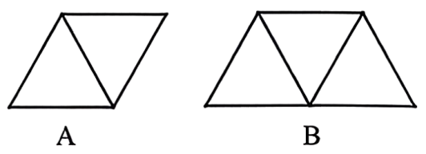

# Mathematics - 题目 1965

**ID**: 944c3159baff45fabfea7f5073654b3e
**年级**: Grade 12
**难度**: Medium-Hard
**题型**: Multiple-select

## 题目
如图，现有两种碎片 $A{\rm{,}}B$ 各若干个，且两种碎片均由等大小的正三角形按图示拼凑而成.​​​​​​​‌若一个大正三角形恰好分割成 $m$ 个 $\mathrm{A}$ 碎片和 $n$ 个 $B$ 碎片，则 $\left ({m{\rm{,}}n}\right )$ 可以是（      ）

## 解答

1. 根据题意作图：
2. 
3. 由图观察可知，一个大正三角形可以拆成： $1+3+5+\cdots +\left ({2t-1}\right )=\frac {t\left ({1+2t-1}\right )}{2}=t{^{2}}$ 个小正三角形，
4. 要想一个大正三角形恰好分割成 $m$ 个 $\mathrm{A}$ 碎片和 $n$ 个 $B$ 碎片，显然需满足 $t\geqslant 3$ .
5. 观察得到 $\mathrm{A}$ 碎片中有2个小正三角形， $B$ 碎片中有3个小正三角形，
6. 若一个大正三角形恰好分割成 $m$ 个 $\mathrm{A}$ 碎片和 $n$ 个 $B$ 碎片，则共有 $2m+3n$ 个小正三角形.
7. 当 $t=3$ 时， $2m+3n=t{^{2}}=9$ ，则只能是 $\begin{cases}m=0\\n=3\end{cases}$ ，故为 $\left ({0,3}\right )$ .
8. 每一排的小三角形个数均为奇数，由正三角形的对称性可知：
9. 每增加一排则至少增加1个 $B$ 碎片，
10. ∴ $n\geqslant t$ ，
11. 对于A选项， $m=2,n=4$ 时， $2m+3n=16=4{^{2}}$ ，即 $t=4$ ，满足条件，A选项正确；
12. 如图
13. 对于B选项， $m=4,n=6$ 时， $2m+3n=26$ ，不是完全平方数，B选项排除；
14. 对于C选项， $m=6,n=8$ 时， $2m+3n=36=6{^{2}}$ ， $t=6$ ，如图满足条件，C选项正确；
15. 
16. 对于D选项， $m=12,n=4$ 时， $2m+3n=36=6{^{2}}$ ， $t=6$ ， $4<6$ 不满足条件，D选项错误；
17. 故选AC.

## 知识点

**中文**:
  - 等差数列模型

**English**:
  - Arithmetic Sequence Models

---
