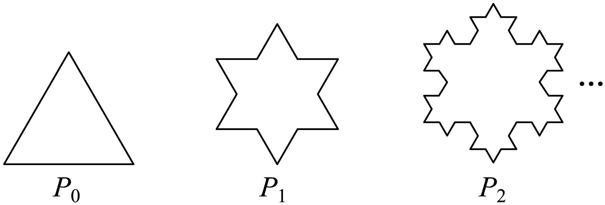

# Mathematics - 题目 460

**ID**: a76910c8315b472caaccfffe40d34e4a
**年级**: Grade 12
**难度**: Medium-Hard
**题型**: Multiple-select

## 题目
如图，有一列曲线 $P{{}_{0}},P{{}_{1}},P{{}_{2}},\cdots $ ，已知 $P{{}_{0}}$ 所围成的图形是面积为1的等边三角形， $P{{}_{k+1}}(k=0,1,2,3,\cdots )$ 是对 $P{{}_{k}}$ 进行如下操作得到的：将 $P{{}_{k}}$ 的每条边三等分，以每边中间部分的线段为边，向外作等边三角形，再将中间部分的线段去掉，记 $S{{}_{k}}$ 为曲线 $P{{}_{k}}$ 所围成图形的面积，则（      ）​​​​​​​‌

## 解答

1. 依题意，令 $P{{}_{0}}$ 图形的边长为 $a$ ， $\frac {\sqrt {3}}{4}a{^{2}}=1$ ，边数是3；
2. 根据图形规律， $P{{}_{1}}$ 图形边长为 $\frac {a}{3}$ ，边数为 $P{{}_{0}}$ 边数的4倍，即 $3\times 4$ ；
3. $P{{}_{2}}$ 图形边长为 $\frac {a}{3{^{2}}}$ ，边数为 $3\times 4{^{2}}$ ；依此类推， $P{{}_{n}}$ 图形边长为 $\frac {a}{3{^{n}}}$ ，边数为 $3\times 4{^{n}}{\rm ，C}$ 正确；
4. $P{{}_{3}}$ 的边数为 $3\times 4{^{3}}=192{\rm ，A}$ 错误；
5. 由图形规律知曲线 $P{{}_{n}}$ 所围图形的面积 $S{{}_{n}}$ 等于曲线 $P{{}_{n-1}}$ 所围面积加上每一条边增加的小等边三角形的面积，
6. 而每一个边增加的小等边三角形面积为 $\frac {\sqrt {3}}{4}\times (\frac {a}{3{^{n}}}){^{2}}$ ，
7. 则 $S{{}_{n}}=S{{}_{n-1}}+(3\times 4{^{n-1}})\times \frac {\sqrt {3}}{4}\times (\frac {a}{3{^{n}}}){^{2}}$ ，整理得 $S{{}_{n}}-S{{}_{n-1}}=\frac {1}{3}\times (\frac {4}{9}){^{n-1}}$ ，
8. 数列 $\{S{{}_{n}}-S{{}_{n-1}}\}$ 是等比数列， $P{{}_{1}}$ 图形的面积 $S{{}_{1}}=1+3\times \frac {\sqrt {3}}{4}\times (\frac {a}{3}){^{2}}=\frac {4}{3}$ ，
9. $S{{}_{n}}=S{{}_{1}}+(S{{}_{2}}-S{{}_{1}})+(S{{}_{3}}-S{{}_{2}})+\cdots +(S{{}_{n}}-S{{}_{n-1}})=\frac {4}{3}+\frac {1}{3}\times \frac {\frac {4}{9}[1-(\frac {4}{9}){^{n-1}}]}{1-\frac {4}{9}}=\frac {8}{5}-\frac {3}{5}\times (\frac {4}{9}){^{n}}{\rm ，D}$ 正确；
10. $S{{}_{2}}=\frac {8}{5}-\frac {3}{5}\times \frac {16}{81}=\frac {40}{27}{\rm ，B}$ 正确.
11. 故选BCD．

## 知识点

**中文**:
  - 数列的定义与表示方法
  - 等比数列的概念与通项公式
  - 等比数列前n项和公式

**English**:
  - Definition and Methods
  - Concept and Formula
  - Sum Formula

---
