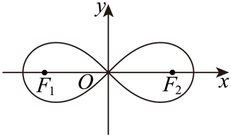

# Mathematics - 题目 701

**ID**: be8dc756ddba4531818ac3de40490335
**年级**: Grade 12
**难度**: Medium-Hard
**题型**: Multiple-select

## 题目
如图，在平面直角坐标系中，曲线 $C$ 为伯努利双纽线，其中 $F{{}_{1}}(-c,0)$ ， $F{{}_{2}}(c,0)$ 为焦点，点 $P(x,y)$ 为 $C$ 上任意一点，且满足 $\left |{PF{{}_{1}}}\right |\cdot \left |{PF{{}_{2}}}\right |=c{^{2}}$ ，曲线 $C$ 的方程为.​​​​​​​‌则下列说法正确的有（      ）

## 解答

1. 对于A，因为 $F{{}_{1}}(-c,0)$ ， $F{{}_{2}}(c,0)$ 关于原点对称，设动点 $P(x,y)$ ，由题可得 $C$ 的轨迹方程，
2. 把 $(x,y)$ 关于原点对称的点 $(-x,-y)$ 代入轨迹方程，把 $(x,y)$ 关于y轴对称的点 $(-x,y)$ 代入轨迹方程，原方程不变，A选项正确；
3. 对于B，由题意得直线 $y=kx$ 与曲线 ${\left({x{^{2}}+y{^{2}}}\right)^{2}}=2c{^{2}}\left ({x{^{2}}-y{^{2}}}\right )$ 一定有公共点 $(0,0)$ ，
4. 联立方程组 $\begin{cases}{\left({x{^{2}}+y{^{2}}}\right)^{2}}=2c{^{2}}\left ({x{^{2}}-y{^{2}}}\right )，\\y=kx，\end{cases}$ ，得到 $x{^{4}}{\left({1+k{^{2}}}\right)^{2}}=2c{^{2}}x{^{2}}\left ({1-k{^{2}}}\right )$ ，
5. 若直线 $y=kx$ 与曲线 $C$ 有3个交点，则方程除 $x=0$ 外无解，
6. 而 $x{^{4}}{\left({1+k{^{2}}}\right)^{2}}>0$ ， $2c{^{2}}x{^{2}}\mathrm{>}0$ ，则 $1-k{^{2}}>0$ 即可，解得 $k\in \left ({-1,1}\right )$ ，故B错误；
7. 因为 $P\left ({x{{}_{0}},y{{}_{0}}}\right )$ ，故 $S{{}_{\vartriangle PF{{}_{1}}F{{}_{2}}}}=\frac {1}{2}\left |{PF{{}_{1}}}\right |\cdot \left |{PF{{}_{2}}}\right |\cdot {\rm{s}}{\rm{i}}{\rm{n}}\angle F{{}_{1}}PF{{}_{2}}=\frac {1}{2}\left |{F{{}_{1}}F{{}_{2}}}\right |\cdot \left |{y{{}_{0}}}\right |$ ，
8. 又 $\left |{PF{{}_{1}}}\right |\cdot \left |{PF{{}_{2}}}\right |=c{^{2}}$ ，所以 $c{^{2}}\sin \angle F{{}_{1}}PF{{}_{2}}=2c\cdot \left |{y{{}_{0}}}\right |$ ，
9. 即 $\left |{y{{}_{0}}}\right |=\frac {c}{2}{\rm{s}}{\rm{i}}{\rm{n}}\angle F{{}_{1}}PF{{}_{2}}\leqslant \frac {c}{2}$ ，故 $-\frac {c}{2}\leqslant y{{}_{0}}\leqslant \frac {c}{2}$ ；
10. 在 $(x{^{2}}+y{^{2}}){^{2}}-2c{^{2}}(x{^{2}}-y{^{2}})=0$ 中，令 $y=0$ ，可得 $x{^{4}}-2c{^{2}}x{^{2}}=0$ ，
11. 解得 $x=0$ 或 $x=\pm \sqrt {2}c$ ，所以 $x\in \left [-\sqrt {2}c,\sqrt {2}c\right ]$ ，
12. 所以曲线 $C$ 在直线 $x=\pm \sqrt {2}c$ 与 $y=\pm \frac {1}{2}c$ 所围成的矩形区域内，C选项正确；
13. 在 $(x{^{2}}+y{^{2}}){^{2}}-2c{^{2}}(x{^{2}}-y{^{2}})=0$ 中，令 $y=\frac {c}{2}$ 时，可得 $x{^{4}}-\frac {3}{2}c{^{2}}x{^{2}}+\frac {9c{^{4}}}{16}=0$ ，
14. 化简得 ${\left({x{^{2}}-\frac {3}{4}c{^{2}}}\right)^{2}}=0$ ，解得 $x=\pm \frac {\sqrt {3}}{2}c$ ，
15. 所以，当参数 $c$ 变化时，曲线 $C$ 上的最高点 $\left ({\pm \frac {\sqrt {3}}{2}c,\frac {1}{2}c}\right )$ 均在曲线 $y=\frac {\sqrt {3}}{3}|x|$ 上，
16. 故D项正确；
17. 故选ACD.

## 知识点

**中文**:
  - 曲线与方程

**English**:
  - Curves and Equations

---
