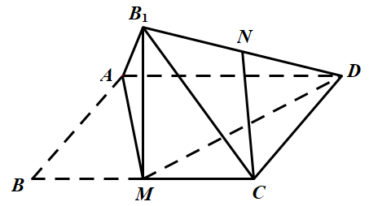

# Mathematics - 题目 2831

**ID**: d05ea25913a541689feeb632ed794dfa
**年级**: Grade 12
**难度**: Medium-Hard
**题型**: Multiple-select

## 题目
如图，在菱形 $ABCD$ 中， $AB=2$ ， $\angle ABC=60{}^\circ $ ， $M$ 为 $BC$ 的中点，将 $\vartriangle ABM$ 沿直线 $AM$ 翻折成 $\vartriangle AB{{}_{1}}M$ ，连接 $B{{}_{1}}C$ 和 $B{{}_{1}}D$ ， $N$ 为 $B{{}_{1}}D$ 的中点，则在翻折过程中，下列说法正确的是（      ）​​​​​​​‌

## 解答

1. 
2. A选项：由题意在菱形 $ABCD$ 中， $AB=2$ ， $M$ 为 $BC$ 的中点，所以 $AM=\frac {1}{2}BC=\frac {1}{2}AB=1$ ，又 $\angle ABC=60{}^\circ $ ，所以 $AM\bot BC$ ，且将 $\vartriangle ABM$ 沿直线 $AM$ 翻折成 $\vartriangle AB{{}_{1}}M$ ，所以 $AM\bot B{{}_{1}}M$ ，又 $B{{}_{1}}M\cap BC=M$ ， $AM\bot $ 平面 $B{{}_{1}}MC$ ，又 $B{{}_{1}}C\subset $ 平面 $B{{}_{1}}MC$ ，所以 $AM\bot B{{}_{1}}C$ ，故A选项正确；
3. B选项：如图所示，取 $AD$ 中点 $E$ ，连接 $EN$ ， $EC$ ，所以 $EC//AM$ ，且 $EC=AM$ ，又因为 $N$ 为 $B{{}_{1}}D$ 的中点，所以 $EN//AB{{}_{1}}$ ，且 $EN=\frac {1}{2}AB{{}_{1}}=1$ 又由A选项得 $AM\bot BC$ ， $\angle ABC=60{}^\circ $ ，所以 $\angle BAM=\angle B{{}_{1}}AM=30{}^\circ $ 且 $AM=\sqrt {3}$ ，所以 $\angle NEC=30{}^\circ $ ， $EC=\sqrt {3}$ ，在 $\vartriangle CEN$ 中，由余弦定理得： $CN{^{2}}=CE{^{2}}+NE{^{2}}-2CE\cdot NE\cdot {\cos}\angle NEC=3+1-2\times \sqrt {3}\times 1\times \frac {\sqrt {3}}{2}=1$ ，即 $CN=1$ ，故B选项正确；
4. C选项：由B选项得 $EN//AB{{}_{1}}$ ，所以 $AB{{}_{1}}$ 与 $CN$ 的夹角 $θ$ 即为 $EN$ 与 $AB{{}_{1}}$ 所成角， $θ\in \left [0,\frac {π}{2}\right ]$ ， $CN=EN=1$ ，且 $\angle NEC=30{}^\circ $ ，所以 $\angle CNE=120{}^\circ $ ，所以 $θ=\frac {π}{3}$ ，故C选项错误；
5. D选项：当三棱锥 $B{{}_{1}}-AMD$ 的体积最大时， $B{{}_{1}}M\bot $ 平面 $ABCD$ ，由四边形 $ABCD$ 为菱形，且 $\angle ABC=60{}^\circ $ ， $\angle BAM=30{}^\circ $ ，可知 $AM\bot AD$ ，故三棱锥 $B{{}_{1}}-AMD$ 的外接球即为其所在矩形的外接球，故外接球半径 $R=\frac {1}{2}\sqrt {AD{^{2}}+AM{^{2}}+B{{}_{1}}M{^{2}}}=\frac {1}{2}\sqrt {4+3+1}=\sqrt {2}$ ，外接球表面积 $S=4πR{^{2}}=8π$ ，故D选项正确；
6. 故选：ABD.

## 知识点

**中文**:
  - 翻折问题

**English**:
  - Folding Problems

---
