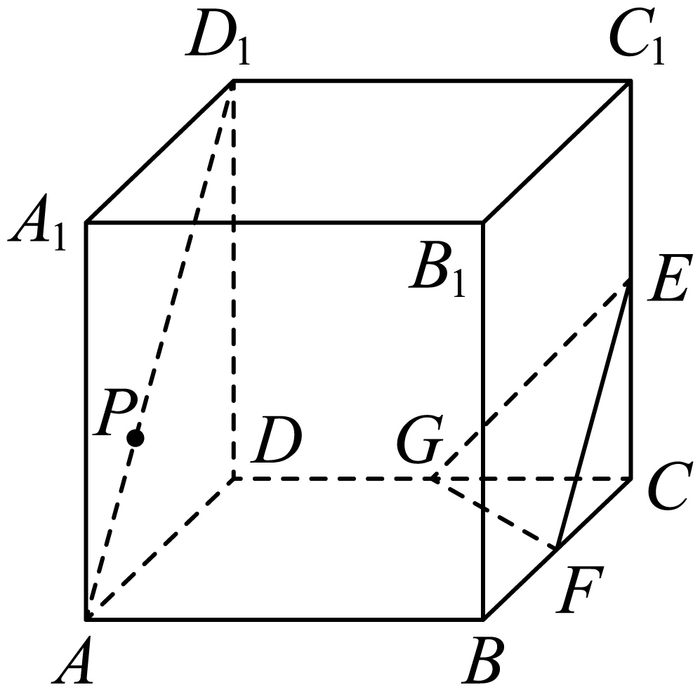

# Mathematics - 题目 2670

**ID**: d27f3124984443f49cb2e628e288b486
**年级**: Grade 12
**难度**: Medium-Hard
**题型**: Multiple-select

## 题目
如图，在棱长为1的正方体 $ABCD-A{{}_{1}}B{{}_{1}}C{{}_{1}}D{{}_{1}}$ 中，点 $E$ ， $F$ ， $G$ 分别是棱 $CC{{}_{1}}$ ， $CB$ ， $CD$ 的中点， $P$ 为线段 $AD{{}_{1}}$ 上的一个动点，平面 $α{\rm{/}}{\rm{/}}$ 平面 $EFG$ ，则下列说法中正确的是（      ）​​​​​​​‌

## 解答

1. 如图，连接 $A{{}_{1}}C$ ， $BC{{}_{1}}$ ， $B{{}_{1}}C$ ， $A{{}_{1}}D$ ，由正方体的性质可知 $BC{{}_{1}}\bot B{{}_{1}}C$ ， $AD{{}_{1}}{\rm{/}}{\rm{/}}BC{{}_{1}}$ ，
2. 又点 $E$ ， $F$ ， $G$ 分别是棱 $CC{{}_{1}}$ ， $CB$ ， $CD$ 的中点，所以 $EF{\rm{/}}{\rm{/}}BC{{}_{1}}$ ，则 $EF\bot B{{}_{1}}C$ ，
3. 又 $DC\bot $ 平面 $BCC{{}_{1}}B{{}_{1}}$ ， $EF\subset $ 平面 $BCC{{}_{1}}B{{}_{1}}$ ，所以 $DC\bot EF$ ，
4. 又 $DC\cap B{{}_{1}}C=C$ ， $DC,B{{}_{1}}C\subset $ 平面 $DCB{{}_{1}}A{{}_{1}}$ ，所以 $EF\bot $ 平面 $DCB{{}_{1}}A{{}_{1}}$ ，
5. 又 $A{{}_{1}}C\subset $ 平面 $DCB{{}_{1}}A{{}_{1}}$ ，
6. 所以 $EF\bot A{{}_{1}}C$ ，同理可证 $GF\bot A{{}_{1}}C$ ，又 $GF\cap EF=F$ ， $GF,EF\subset $ 平面 $EFG$ ，
7. 所以 $A{{}_{1}}C\bot $ 平面 $EFG$ ，由 $A{{}_{1}}C$ 与 $AD{{}_{1}}$ 异面可知，
8. 不存在点 $P$ ，使得 $CP\bot $ 平面 $EFG$ ，故A正确；
9. 
10. 因为 $AD{{}_{1}}{\rm{/}}{\rm{/}}BC{{}_{1}}$ ， $EF{\rm{/}}{\rm{/}}BC{{}_{1}}$ ，所以 $AD{{}_{1}}{\rm{/}}{\rm{/}}EF$ ，又 $AD{{}_{1}}\not\subset $ 平面 $EFG$ ， $EF\subset $ 平面 $EFG$ ，
11. 所以 $AD{{}_{1}}{\rm{/}}{\rm{/}}$ 平面 $EFG$ ，所以动点 $P$ 到平面 $EFG$ 的距离为定值，
12. 又 $\vartriangle EFG$ 的面积为定值，所以三棱锥 $P-EFG$ 的体积为定值，故B正确；
13. 如图，正六边形 $IJKLMN$ （其中 $I$ ， $J$ ， $K$ ， $L$ ， $M$ ， $N$ 都是对应棱的中点），
14. 
15. 根据正方体的性质可知 $JK{\rm{/}}{\rm{/}}EF{\rm{/}}{\rm{/}}MN$ ， $NI{\rm{/}}{\rm{/}}GF{\rm{/}}{\rm{/}}LK$ ， $IJ{\rm{/}}{\rm{/}}LM{\rm{/}}{\rm{/}}GE$ ，
16. $JK\not\subset $ 平面 $EFG$ ， $EF\subset $ 平面 $EFG$ ，所以 $JK{\rm{/}}{\rm{/}}$ 平面 $EFG$ ，
17. 同理可证 $IJ{\rm{/}}{\rm{/}}$ 平面 $EFG$ ，又 $JK\cap IJ=J$ ， $JK,IJ\subset $ 平面 $IJKLMN$ ，
18. 所以平面 $IJKLMN{\rm{/}}{\rm{/}}$ 平面 $EFG$ ，
19. 又该正六边形 $IJKLMN$ 的边长为 $\frac {\sqrt {2}}{2}$ ，所以其面积为 $6\times \frac {\sqrt {3}}{4}\times {\left({\frac {\sqrt {2}}{2}}\right)^{2}}=\frac {3\sqrt {3}}{4}$ ，
20. 因为平面 $α{\rm{/}}{\rm{/}}$ 平面 $EFG$ ，
21. 所以当截面为正六边形 $IJKLMN$ 时，平面 $α$ 截该正方体所得截面的面积取得最大值，
22. 最大值为 $\frac {3\sqrt {3}}{4}$ ，故C错误；
23. 平面 $α$ 截该正方体所得截面可能为三角形，也可能为六边形，故D正确，
24. 故选ABD.

## 知识点

**中文**:
  - 截面问题
  - 棱柱、棱锥、棱台的体积
  - 直线与平面垂直的判定

**English**:
  - Cross-section Problems
  - Volume of Polyhedra
  - Line-Plane Perpendicularity Determination

---
