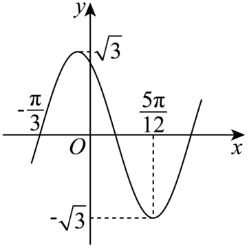

# Mathematics - 题目 1174

**ID**: df0867ff9af04955950f4b92e0f8daec
**年级**: Grade 12
**难度**: Medium-Hard
**题型**: Multiple-select

## 题目
已知函数 $f\left ({x}\right )=A\sin \left ({ωx+φ}\right )\left ({A>0,ω>0,0<φ<{\rm{π}}}\right )$ 的部分图象如图所示，令 $g\left ({x}\right )=f\left ({x}\right )-{\cos}2x$ ，则下列说法正确的有（      ）．​​​​​​​‌

## 解答

1. 由题图可得 $A=\sqrt {3}$ ， $\frac {3}{4}T=\frac {3}{4}\times \frac {2{\rm{π}}}{ω}=\frac {5{\rm{π}}}{12}-\left ({-\frac {{\rm{π}}}{3}}\right )=\frac {3{\rm{π}}}{4}$ ，解得 $ω=2$ ．
2. 又 $f\left ({\frac {5{\rm{π}}}{12}}\right )=\sqrt {3}\sin \left ({\frac {5{\rm{π}}}{6}+φ}\right )=-\sqrt {3}$ ，
3. 可得 $\frac {5{\rm{π}}}{6}+φ=\frac {3{\rm{π}}}{2}+2k{\rm{π}}\left ({k\in {\mathbf{Z}}}\right )$ ，解得 $φ=\frac {2{\rm{π}}}{3}+2k{\rm{π}}\left ({k\in {\mathbf{Z}}}\right )$ ．
4. 因为 $0<φ<{\rm{π}}$ ，所以 $φ=\frac {2{\rm{π}}}{3}$ ，所以 $f\left ({x}\right )=\sqrt {3}\sin \left ({2x+\frac {2{\rm{π}}}{3}}\right )$ ．
5. 所以 $g\left ({x}\right )=f\left ({x}\right )-{\cos}2x=\sqrt {3}\sin \left ({2x+\frac {2{\rm{π}}}{3}}\right )-{\cos}2x$
6. $=-\frac {\sqrt {3}}{2}\sin 2x+\frac {3}{2}{\cos}2x-{\cos}2x$  $=\frac {1}{2}{\cos}2x-\frac {\sqrt {3}}{2}\sin 2x={\cos}\left ({2x+\frac {{\rm{π}}}{3}}\right )$ ．
7. 对于A项，当 $x=\frac {{\rm{π}}}{6}$ ， $g\left ({x}\right )={\cos}\left ({2\times \frac {{\rm{π}}}{6}+\frac {{\rm{π}}}{3}}\right )={\cos}\frac {2{\rm{π}}}{3}=-\frac {1}{2}$ ，
8. 所以 $\left ({\frac {{\rm{π}}}{6},0}\right )$ 不是 $g\left ({x}\right )$ 的一个对称中心，故A项错误；
9. 对于B项，令 $2x+\frac {{\rm{π}}}{3}={\rm{π}}+k{\rm{π}}$ ，可得 $x=\frac {k{\rm{π}}}{2}+\frac {{\rm{π}}}{3}\left ({k\in {\mathbf{Z}}}\right )$ ，
10. 故 $g\left ({x}\right )$ 的对称轴方程为 $x=\frac {k{\rm{π}}}{2}+\frac {{\rm{π}}}{3}\left ({k\in {\mathbf{Z}}}\right )$ ，故B项正确；
11. 对于C项， $x\in \left [0,\frac {{\rm{π}}}{2}\right ]$ 时， $2x+\frac {{\rm{π}}}{3}\in \left [\frac {{\rm{π}}}{3},\frac {4{\rm{π}}}{3}\right ]$ ，所以 ${\cos}\left ({2x+\frac {{\rm{π}}}{3}}\right )\in \left [-1,\frac {1}{2}\right ]$ ，
12. 所以 $g\left ({x}\right )$ 在 $\left [0,\frac {{\rm{π}}}{2}\right ]$ 上的值域为 $\left [-1,\frac {1}{2}\right ]$ ，故C项正确；
13. 对于D，令 $2k{\rm{π}}\leqslant 2x+\frac {{\rm{π}}}{3}\leqslant {\rm{π}}+2k{\rm{π}}\left ({k\in {\mathbf{Z}}}\right )$ ，解得 $-\frac {{\rm{π}}}{6}+k{\rm{π}}\leqslant x\leqslant \frac {{\rm{π}}}{3}+k{\rm{π}}\left ({k\in {\mathbf{Z}}}\right )$ ，
14. 所以 $g\left ({x}\right )$ 的单调递减区间为 $\left [k{\rm{π}}-\frac {{\rm{π}}}{6},k{\rm{π}}+\frac {{\rm{π}}}{3}\right ]\left ({k\in {\mathbf{Z}}}\right )$ ，故D项正确．
15. 故选BCD．

## 知识点

**中文**:
  - 余弦函数的单调性
  - 余弦函数的最大值与最小值
  - 余弦函数的对称性
  - 函数y=Asin（ωx＋φ）的图象和性质

**English**:
  - Monotonicity of Cosine Function
  - Max and Min of Cosine Function
  - Symmetry of Cosine Function
  - Graph and Properties of y=Asin(ωx+φ)

---
