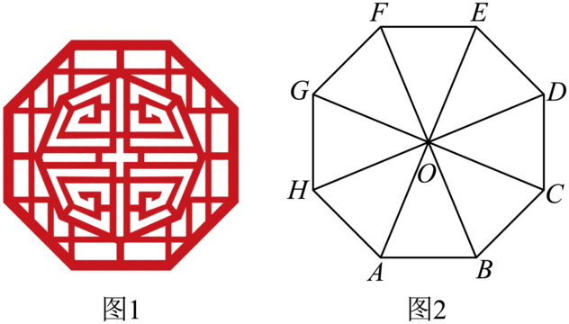

# Mathematics - 题目 1344

**ID**: f6d9cf7f2a8c43e28ce221989df40c8c
**年级**: Grade 12
**难度**: Medium-Hard
**题型**: Multiple-select

## 题目
窗花是贴在窗户上的剪纸，是中国古老的传统民间艺术之一，图1是一个正八边形窗花，图2是从窗花图中抽象出几何图形的示意图.​​​​​​​‌已知正八边形 $ABCDEFGH$ 的边长为 ${\rm 2，}P$ 是正八边形 $ABCDEFGH$ 边上任意一点，则下列说法正确的是（      ）

## 解答

1. 如图所示，以AE为y轴，GC为x轴建立平面直角坐标系，
2. 设 $\left |{OA}\right |=a$ ，则在 $\mathrm{△}OAB$ 中，由余弦定理可得 $a{^{2}}+a{^{2}}-2a{^{2}}{\cos}\frac {{\rm{π}}}{4}=4$ ，
3. 整理得 $a{^{2}}=4+2\sqrt {2}$ ，
4. 因为 $A\left ({0,-a}\right ),B\left ({\frac {\sqrt {2}}{2}a,-\frac {\sqrt {2}}{2}a}\right ),C\left ({a,0}\right ),D\left ({\frac {\sqrt {2}}{2}a,\frac {\sqrt {2}}{2}a}\right ),E\left ({0,a}\right ),F\left ({-\frac {\sqrt {2}}{2}a,\frac {\sqrt {2}}{2}a}\right ),$
5. $G\left ({-a,0}\right ),H\left ({-\frac {\sqrt {2}}{2}a,-\frac {\sqrt {2}}{2}a}\right )$ .
6. 对于A，因为 $\overrightarrow {{OA}}+\overrightarrow {{OC}}=\left ({a,-a}\right ),\overrightarrow {{OB}}=\left ({\frac {\sqrt {2}}{2}a,-\frac {\sqrt {2}}{2}a}\right )$ ，
7. 所以 $\sqrt {3}\overrightarrow {{OB}}=\left ({\frac {\sqrt {6}}{2}a,-\frac {\sqrt {6}}{2}a}\right )\ne \overrightarrow {{OA}}+\overrightarrow {{OC}}{\rm ，A}$ 错误；
8. 对于B，取AB的中点为M，则 $\overrightarrow {{PA}}+\overrightarrow {{PB}}=2\overrightarrow {{PM}},\overrightarrow {{PA}}-\overrightarrow {{PB}}=\overrightarrow {{BA}}=2\overrightarrow {{MA}}$ ，
9. 则 ${\left({\overrightarrow {{PA}}+\overrightarrow {{PB}}}\right)^{2}}=4\overrightarrow {{PM}}{^{2}},{\left({\overrightarrow {{PA}}-\overrightarrow {{PB}}}\right)^{2}}=4\overrightarrow {{MA}}{^{2}}$ ，
10. 两式相减得 $\overrightarrow {{PA}}\cdot \overrightarrow {{PB}}=\overrightarrow {{PM}}{^{2}}-\overrightarrow {{MA}}{^{2}}=\overrightarrow {{PM}}{^{2}}-1$ ，
11. 由正八边形的对称性可知，当点P与点E或点F重合时， $\overrightarrow {{PM}}{^{2}}$ 最大，
12. 又 $M\left ({\frac {\sqrt {2}}{4}a,-\frac {1}{2}a-\frac {\sqrt {2}}{4}a}\right )$ ，所以 $\overrightarrow {{EM}}=\left ({\frac {\sqrt {2}}{4}a,-\frac {3}{2}a-\frac {\sqrt {2}}{4}a}\right )$ ，
13. 所以 $\overrightarrow {{EM}}{^{2}}={\left({\frac {\sqrt {2}}{4}a}\right)^{2}}+{\left({-\frac {3}{2}a-\frac {\sqrt {2}}{4}a}\right)^{2}}=\frac {10+3\sqrt {2}}{4}a{^{2}}=13+8\sqrt {2}$ ，
14. 所以， $\overrightarrow {{PA}}\cdot \overrightarrow {{PB}}$ 的最大值为 $\overrightarrow {{PA}}\cdot \overrightarrow {{PB}}=\overrightarrow {{PM}}{^{2}}-1=12+8\sqrt {2}{\rm ，B}$ 正确；
15. 对于 ${\rm C，}\overrightarrow {{AG}}=\left ({-a,a}\right ),\overrightarrow {{AB}}=\left ({\frac {\sqrt {2}}{2}a,a-\frac {\sqrt {2}}{2}a}\right )$ ，
16. 所以 $\frac {\overrightarrow {{AG}}\cdot \overrightarrow {{AB}}}{\left |{\overrightarrow {{AB}}}\right |{^{2}}}=\frac {-\frac {\sqrt {2}}{2}a{^{2}}+a{^{2}}-\frac {\sqrt {2}}{2}a{^{2}}}{\frac {1}{2}a{^{2}}+{\left({a-\frac {\sqrt {2}}{2}a}\right)^{2}}}=-\frac {\sqrt {2}}{2}$ ，
17. 所以 $\overrightarrow {{AG}}$ 在 $\overrightarrow {{AB}}$ 方向上的投影向量为 $-\frac {\sqrt {2}}{2}\overrightarrow {{AB}}{\rm ，C}$ 错误；
18. 对于D，因为 $\overrightarrow {{AD}}=\left ({\frac {\sqrt {2}}{2}a,\frac {\sqrt {2}}{2}a+a}\right )$ ， $\overrightarrow {{AB}}=\left ({\frac {\sqrt {2}}{2}a,a-\frac {\sqrt {2}}{2}a}\right )$ ，
19. 所以 $\overrightarrow {{AD}}-x\overrightarrow {{AB}}=\left ({\frac {\sqrt {2}}{2}a\left ({1-x}\right ),\frac {\sqrt {2}}{2}a\left ({1+x}\right )+a\left ({1-x}\right )}\right )$ ，
20. 所以 $f\left ({x}\right )=\sqrt {\left [\frac {\sqrt {2}}{2}a\left ({1-x}\right )\right ]{^{2}}+\left [\frac {\sqrt {2}}{2}a\left ({1+x}\right )+a\left ({1-x}\right )\right ]{^{2}}}$
21. $=\sqrt {\left ({2+\sqrt {2}}\right )a{^{2}}+\left ({2-\sqrt {2}}\right )a{^{2}}x{^{2}}-2a{^{2}}x}=2\sqrt {x{^{2}}-\left ({2+\sqrt {2}}\right )x+3+2\sqrt {2}}$ ，
22. 当 $x=1+\frac {\sqrt {2}}{2}$ 时，函数 $f\left ({x}\right )$ 取得最小值 $2+\sqrt {2}{\rm ，D}$ 正确.
23. 故选BD
24. 

## 知识点

**中文**:
  - 向量的投影
  - 数量积的计算
  - 向量线性综合运算

**English**:
  - Vector Projection
  - Calculation of Scalar Product
  - Comprehensive Linear Operations

---
