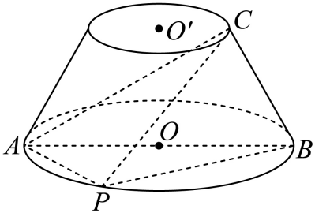

# Mathematics - 题目 525

**ID**: fe9519f60eae48c99baec1150c1ba8e3
**年级**: Grade 12
**难度**: Medium-Hard
**题型**: Multiple-select

## 题目
如图，已知圆台 $OO^{′}$ 的下底面直径 $AB=4$ ，母线 $BC=2$ ，且 $AC\bot BC$ ，P是下底面圆周上一动点，则（      ）​​​​​​​‌

## 解答

1. 圆台 $OO^{′}$ 中，作出圆 $O^{′}$ 过点 $C$ 的直径 $CD$ ，则四边形 $ABCD$ 是等腰梯形，作 $CE\bot AB$ 于 $E$ ，
2. 
3. 在 $△ABC$ 中，由 $AB=4,BC=2,AC\bot BC$ ，得 $\angle ABC=60{^{\circ }},CE=\sqrt {3},BE=1$ ，
4. 则 $CD=AB-2BE=2$ ，
5. 对于A，圆台 $OO^{′}$ 的表面积 $S={\rm{π}}\times 1{^{2}}+{\rm{π}}\times 2{^{2}}+{\rm{π}}\times (1+2)\times 2=11{\rm{π}}$ ，A错误；
6. 对于B，圆台 $OO^{′}$ 的体积 $V=\frac {1}{3}{\rm{π}}(1{^{2}}+1\times 2+2{^{2}})\times \sqrt {3}=\frac {7\sqrt {3}}{3}{\rm{π}}$ ，B正确；
7. 对于C，由P是下底面圆周上一动点，得点 $P$ 到直线 $AB$ 距离的最大值为2，
8. 则 $△APB$ 面积的最大值为 $\frac {1}{2}\times 2\times 4=4$ ，三棱锥 $A-BCP$ 体积的最大值为 $\frac {1}{3}\times 4\times \sqrt {3}=\frac {4\sqrt {3}}{3}$ ，
9. C错误；
10. 对于D，连接 $PE$ ，当 $P$ 与点 $A,B$ 都不重合时，设 $\angle PAB=θ(0{^{\circ }}<θ<90{^{\circ }}),t={\cos}θ\in (0,1)$ ，
11. 则 $AP=4{\cos}θ=4t$ ，在 $\mathrm{△}AEP$ 中，由余弦定理得 $PE{^{2}}=3{^{2}}+(4t){^{2}}-2\times 3\times 4t{\cos}θ=9-8t{^{2}}$ ，
12. 于是 $PC=\sqrt {CE{^{2}}+PE{^{2}}}=\sqrt {12-8t{^{2}}}$ ， $f(t)=AP+PC=4t+\sqrt {12-8t{^{2}}}$ ，
13. 求导得 $f^{′}(t)=4-\frac {4t}{\sqrt {3-2t{^{2}}}}$ ，显然 $(\sqrt {3-2t{^{2}}}){^{2}}-t{^{2}}=3(1-t{^{2}})>0$ ，则 $f^{′}(t)>0$ ，
14. 函数 $f(t)$ 在 $(0,1)$ 上单调递增， $f(t)<f(1)=6$ ，当 $P$ 与 $A$ 重合时， $PA+PC=AC=2\sqrt {3}$ ，
15. 当 $P$ 与 $B$ 重合时， $PA+PC=BA+BC=6$ ，因此 $PA+PC$ 的最大值为6，D正确.
16. 故选BD.

## 知识点

**中文**:
  - 圆柱、圆锥、圆台的体积
  - 导数在优化问题中的应用
  - 圆柱、圆锥、圆台的表面积（侧面积）
  - 棱柱、棱锥、棱台的体积

**English**:
  - Volume of Revolving Solids
  - Optimization Problems
  - Surface Area of Revolving Solids
  - Volume of Polyhedra

---
