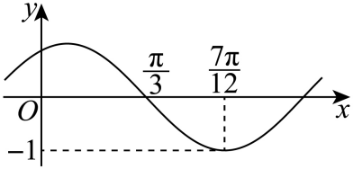

# Mathematics - 题目 1145

**ID**: 1e9f119e33ad4f03b90e782f6468d3c5
**年级**: Grade 12
**难度**: Medium
**题型**: Multiple-choice

## 题目
函数 $f\left ({x}\right )=A{\rm{c}}{\rm{o}}{\rm{s}}\left ({ωx+φ}\right )$ 的图象如图所示，其中 $ω>0$ ， $\left |{φ}\right |<\frac {{\rm{π}}}{2}$ ， 为了得到 $g\left ({x}\right )=A{\rm{c}}{\rm{o}}{\rm{s}}ωx$ 的图象，可以将 $f\left ({x}\right )$ 的图象 （      ）​​​​​​​‌

## 解答

1. 由函数图象可知， $A=1$ ，函数过 $\left ({\frac {{\rm{π}}}{3},0}\right )$ ， $\left ({\frac {7{\rm{π}}}{12},-1}\right )$ 两点，
2. 设 $f\left ({x}\right )=A{\rm{c}}{\rm{o}}{\rm{s}}\left ({ωx+φ}\right )$ 的最小正周期为 $T$ ，因为 $ω>0$ ，所以有 $T=\frac {2{\rm{π}}}{ω}$ ，
3. 而 $\frac {T}{4}=\frac {7{\rm{π}}}{12}-\frac {{\rm{π}}}{3}=\frac {{\rm{π}}}{4}\Rightarrow T={\rm{π}}$ ，因此 $ω=2$ ，即 $f\left ({x}\right )={\cos}\left ({2x+φ}\right )$ ，
4. 因为 $f\left ({\frac {{\rm{π}}}{3}}\right )=0$ ，
5. 所以 $f\left ({x}\right )={\cos}\left ({\frac {2{\rm{π}}}{3}+φ}\right )=0$ ，即 $\frac {2{\rm{π}}}{3}+φ=2k{\rm{π}}+\frac {{\rm{π}}}{2}\left ({k\in \mathbf{Z}}\right )$ ，
6. 所以 $φ=2k{\rm{π}}-\frac {{\rm{π}}}{6}\left ({k\in \mathbf{Z}}\right )$ ，
7. 因为 $\left |{φ}\right |<\frac {{\rm{π}}}{2}$ ，所以 $k=0$ ，即 $φ=-\frac {{\rm{π}}}{6}$ ，
8. 因此 $f\left ({x}\right )={\cos}\left ({2x-\frac {{\rm{π}}}{6}}\right )={\cos}\left [2\left ({x-\frac {{\rm{π}}}{12}}\right )\right ]$ ，
9. 而 $g\left ({x}\right )=A{\cos}ωx={\cos}2x$ ，
10. 所以将 $f\left ({x}\right )$ 的图象向左平移 $\frac {{\rm{π}}}{12}$ 个单位长度得到 $g\left ({x}\right )={\cos}2x$ 的图象.
11. 故选C

## 知识点

**中文**:
  - 三角函数的图象变换
  - 函数y=Asin（ωx＋φ）的图象和性质

**English**:
  - Transformation of Trigonometric Graphs
  - Graph and Properties of y=Asin(ωx+φ)

---
