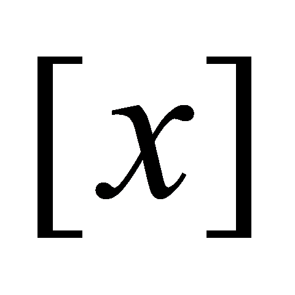

# Mathematics - 题目 2805

**ID**: 23f33d7ac62f4b1caf731fbe99866132
**年级**: Grade 12
**难度**: Medium
**题型**: Multiple-choice

## 题目
高斯是德国著名的数学家，近代数学的奠基者之一，享有“数学王子”的称号，用其名字命名的“高斯函数”为：设，用表示不超过x的最大整数，则称为“高斯函数”，例如：，．已知数列满足，，，若，为数列的前n项和，则（      ）​​​​​​​‌

## 解答

1. 由，得．又，所以数列构成以2为首项，2为公比的等比数列，
2. 所以.
3. 又，，…，，
4. 叠加可得，
5. 即，
6. 所以.
7. 又因为满足上式，所以.
8. 所以.
9. 因为，所以，
10. 即，所以.
11. 故.
12. 所以.
13. 故选：C.

## 知识点

**中文**:
  - 数列求和方法之裂项相消法
  - 数列通项求法之累加法
  - 数列通项求法之构造法

**English**:
  - Telescoping Series Method
  - Accumulation Method (Telescoping Sums)
  - Construction Method

---
