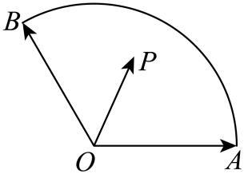

# Mathematics - 题目 2720

**ID**: 4b5a19887edc4ee4b3c502841636ede0
**年级**: Grade 12
**难度**: Medium
**题型**: Multiple-choice

## 题目
如图，扇形 $AOB$ 所在圆的圆心角大小为 $\frac {2{\rm{π}}}{3},P$ 是扇形内部（包括边界）任意一点，若 $\overrightarrow {{OP}}=x\overrightarrow {{OA}}+y\overrightarrow {{OB}}$ ，那么 $2\left ({x+y}\right )$ 的最大值是（      ）​​​​​​​‌

## 解答

1. 以点 $O$ 为坐标原点， $OA$ 所在直线为 $x$ 轴，垂直OA的直线为y轴，建立如图所示的平面直角坐标系，
2. 
3. 设扇形 $AOB$ 的半径为 $r$ ，则 $A\left ({r,0}\right )，B\left ({-\frac {r}{2},\frac {\sqrt {3}}{2}r}\right )$ ，
4. 设OP的长度为 ${\rm \mathit{a}，}\angle AOP=θ$ ，则 $P\left ({a{\rm{c}}{\rm{o}}{\rm{s}}θ,a{\rm{s}}{\rm{i}}{\rm{n}}θ}\right )\left ({0\leqslant a\leqslant r,0\leqslant θ\leqslant \frac {2{\rm{π}}}{3}}\right )$ ，
5. 因为 $\overrightarrow {{OP}}=x\overrightarrow {{OA}}+y\overrightarrow {{OB}}=x\left ({r,0}\right )+y\left ({-\frac {r}{2},\frac {\sqrt {3}}{2}r}\right )=\left ({xr-\frac {ry}{2},\frac {\sqrt {3}}{2}ry}\right )$ ，
6. 所以 $\begin{cases}xr-\frac {yr}{2}=a{\rm{c}}{\rm{o}}{\rm{s}}θ\\\frac {\sqrt {3}}{2}yr=a{\rm{s}}{\rm{i}}{\rm{n}}θ\end{cases}$ ，所以 $\begin{cases}2x-y=\frac {2a}{r}{\rm{c}}{\rm{o}}{\rm{s}}θ\\y=\frac {2\sqrt {3}a}{3r}{\rm{s}}{\rm{i}}{\rm{n}}θ\end{cases}$ ，
7. 所以 $2\left ({x+y}\right )=\left ({2x-y}\right )+3y=\frac {2a}{r}{\rm{c}}{\rm{o}}{\rm{s}}θ+\frac {2\sqrt {3}a}{r}{\rm{s}}{\rm{i}}{\rm{n}}θ=\frac {4a}{r}{\rm{s}}{\rm{i}}{\rm{n}}\left ({θ+\frac {{\rm{π}}}{6}}\right )$ ，
8. 因为 $0\leqslant θ\leqslant \frac {2{\rm{π}}}{3}$ ，则 $\frac {{\rm{π}}}{6}\leqslant θ+\frac {{\rm{π}}}{6}\leqslant \frac {5{\rm{π}}}{6}$ ，
9. 当 $θ+\frac {{\rm{π}}}{2}=\frac {{\rm{π}}}{2}$ 且 $a=r$ 时， $2\left ({x+y}\right )$ 取得最大值4.
10. 故选C.

## 知识点

**中文**:
  - 平面向量的坐标运算
  - 平面向量运算中的参数求解

**English**:
  - Coordinate Operations
  - Solving Parameters in Vector Operations

---
