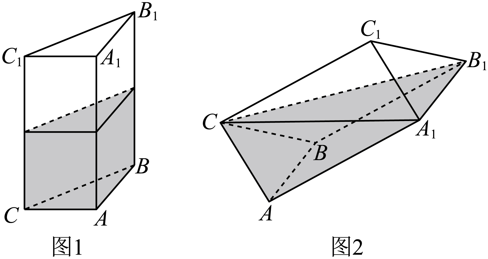

# Mathematics - 题目 1917

**ID**: 4eba32a48186405899d93e3274fa69e9
**年级**: Grade 12
**难度**: Medium
**题型**: Multiple-choice

## 题目
如图1，在高为 $h$ 的直三棱柱容器 $ABC-A{{}_{1}}B{{}_{1}}C{{}_{1}}$ 中，现往该容器内灌进一些水，水深为2，然后固定容器底面的一边 $AB$ 于地面上，再将容器倾斜，当倾斜到某一位置时，水面恰好为 $A{{}_{1}}B{{}_{1}}C$ （如图2），则容器的高 $h$ 为（      ）​​​​​​​‌

## 解答

1. 解：在图（1）中的几何体中，水的体积为 $V{{}_{1}}=S{{}_{\vartriangle ABC}}\times 2=2S{{}_{\vartriangle ABC}}$ ,
2. 在图（2）的几何体中，水的体积为： $V{{}_{2}}=V{{}_{ABC-A{{}_{1}}B{{}_{1}}C}}{{}_{1}}-V{{}_{C-A{{}_{1}}B{{}_{1}}C{{}_{1}}}}=S{{}_{\vartriangle ABC}}\times h-\frac {1}{3}\times S{{}_{\vartriangle A{{}_{1}}B{{}_{1}}C}}{{}_{1}}\times h=\frac {2}{3}S{{}_{\vartriangle ABC}}h$ ，
3. 因为 $V{{}_{1}}=V{{}_{2}}$ ，可得 $\frac {2}{3}S{{}_{\vartriangle ABC}}h=2S{{}_{\vartriangle ABC}}$ ，解得 $h=3$ .
4. 故选：B.

## 知识点

**中文**:
  - 棱柱、棱锥、棱台的体积

**English**:
  - Volume of Polyhedra

---
