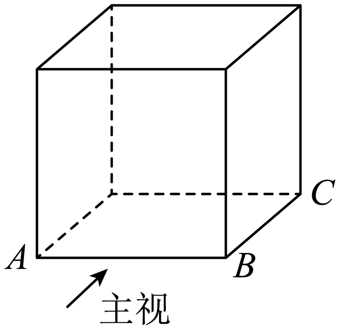

# Mathematics - 题目 2181

**ID**: 54655369708b42c5a2bd7fab7b698345
**年级**: Grade 12
**难度**: Medium
**题型**: Multiple-choice

## 题目
如图，A，B，C是正方体的顶点， $AB=2$ ，点P在正方体的表面上运动，若三棱锥 $P-ABC$ 的主视图、左视图的面积都是1，俯视图的面积为2，则 $PA$ 的取值范围为（      ）​​​​​​​‌

## 解答

1. 如图，取 $AA{{}_{1}},BB{{}_{1}},CC{{}_{1}}$ 的中点 $M,N,Q$ ，连接 $MN,NQ,QM$ ，
2. 则当点P的轨迹为 $△MNQ$ (含边界)时，
3. 三棱锥 $P-ABC$ 的主视图、左视图的面积都是1，俯视图的面积为2，
4. 此时若P与M重合， $PA$ 最小，且最小值为1，
5. 若P与Q重合， $PA$ 最大，且最大值为 $\sqrt {2{{}^{2}}+2{{}^{2}}+1{{}^{2}}}{\rm{=}}3$ ，
6. 所以 $PA$ 的取值范围为 $[1,3]$ .
7. 故选：D.
8. 

## 知识点

**中文**:
  - 动点问题
  - 柱、锥、台、球的三视图

**English**:
  - Moving Point Problems
  - Three-view Drawings of Basic Solids

---
