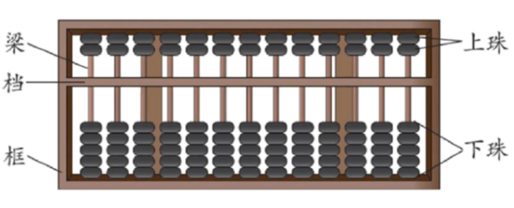

# Mathematics - 题目 620

**ID**: 58b894d4b56741e8afbb5b03a9e1bbc5
**年级**: Grade 12
**难度**: Medium
**题型**: Multiple-choice

## 题目
算盘是中国传统的计算工具，是中国人在长期使用算筹的基础上发明的，是中国古代一项伟大的、重要的发明，在阿拉伯数字出现前是全世界广为使用的计算工具．“珠算”一词最早见于东汉徐岳所撰的《数术记遗》，其中有云：“珠算控带四时，经纬三才．”北周甄鸾为此作注，大意是：把木板刻为3部分，上、下两部分是停游珠用的，中间一部分是作定位用的．下图是一把算盘的初始状态，自右向左，分别是个位、十位、百位、…，上面一粒珠（简称上珠）代表5，下面一粒珠（简称下珠）代表1，即五粒下珠的大小等于同组一粒上珠的大小．现在从个位、十位和百位这三组中随机选择往下拨1粒上珠，且往上拨2粒下珠，则算盘表示的数的个数为（      ）​​​​​​​‌

## 解答

1. 根据珠算的运算法则及题干描述的操作，从个、十、百上珠中选1粒往下拨即 ${\rm C}{_{3}^{1}}$ ，下珠往上拨分两种情况，全部来自个、十、百即 ${\rm C}{_{3}^{1}}$ 或来自个、十、百中的两个即 ${\rm C}{_{3}^{2}}$ ，
2. 则总数为 ${\rm C}{_{3}^{1}}({\rm C}{_{3}^{1}}+{\rm C}{_{3}^{2}})=18$ .
3. 故选：B.

## 知识点

**中文**:
  - 其它有限制条件的组合问题

**English**:
  - Other Restricted Combination Problems

---
