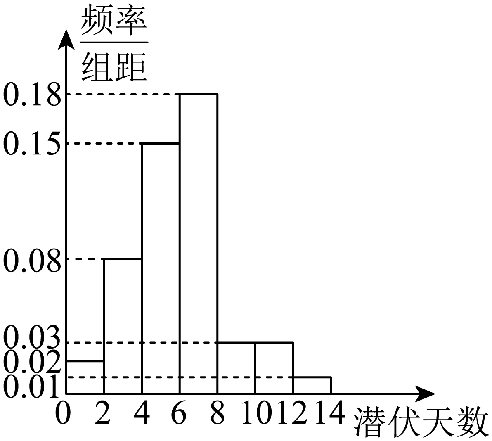

# Mathematics - 题目 3474

**ID**: 6db1f3f6cf8e484ebb524b4ac42fefa4
**年级**: Grade 12
**难度**: Medium
**题型**: Multiple-choice

## 题目
为了解某病毒的致病潜伏期，通过简单随机抽样，获取100名患者的相关信息，并制作了如图所示的频率分布直方图：根据图中数据，估计病毒潜伏天数的样本数据的68%分位数是（      ）​​​​​​​‌

## 解答

1. 由频率分布直方图可知，潜伏期不高于 $6$ 天的患者所占的比例为 $\left ({0.02+0.08+0.15}\right )\times 2=0.5$ ，
2. 潜伏期不高于 $8$ 天的患者所占的比例为 $0.5+0.18\times 2=0.86$ ，
3. 因此， $68\%$ 分位数一定位于 $\left [{6,8}\right )$ 内，
4. 由 $6+2\times \frac {0.68-0.5}{0.86-0.5}=7$ ，所以可估计样本的 $68\%$ 分位数为 $7$ .
5. 故选B

## 知识点

**中文**:
  - 百分位数
  - 频率分布直方图

**English**:
  - Percentile
  - Frequency Distribution Histogram

---
