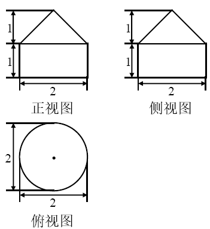

# Mathematics - 题目 953

**ID**: 71e2dfd084dd44ec90dbd6db3cf7a6fa
**年级**: Grade 12
**难度**: Medium
**题型**: Multiple-choice

## 题目
一个几何体的三视图如图所示，则这个几何体的体积为（      ）​​​​​​​‌

## 解答

1. 根据三视图可知几何体是由有公共的底面的圆锥和圆柱体的组合体，
2. 由三视图可知，圆锥的底面半径为1，高为1，圆柱的底面半径为1，高为1
3. 所以组合体的体积为 $\frac {1}{3}π\times 1{^{2}}\times 1+π\times 1{^{2}}\times 1=\frac {4π}{3}$
4. 故选：A
5. 

## 知识点

**中文**:
  - 三视图与体积
  - 简单组合体的表面积与体积

**English**:
  - Three-view Drawings and Volume
  - Area and Volume of Composite Solids

---
