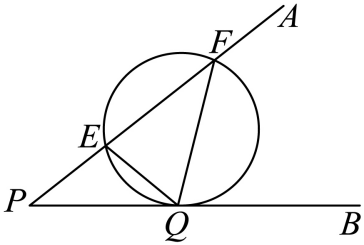

# Mathematics - 题目 3118

**ID**: 801d635bc2c94663984df7ad309d8199
**年级**: Grade 12
**难度**: Medium
**题型**: Multiple-choice

## 题目
几何学史上有一个著名的米勒问题：“设 $E,F$ 是锐角 $∠APB$ 的一边 $PA$ 上的两点，试在边 $PB$ 上找一点 $Q$ ，使得 $\angle EQF$ 最大．”如图，其结论是：点 $Q$ 为过 $E,F$ 两点且和射线 $PB$ 相切的圆的切点．根据以上结论解决以下问题：在平面直角坐标系 $xoy$ 中，给定两点 $E\left ({2,4}\right ),F\left ({4,2}\right )$ ，点 $Q$ 在 $y$ 轴上移动，则 $\angle EQF$ 的最大值为（      ）​​​​​​​‌

## 解答

1. 设圆心 $C$ 坐标为 $\left ({a,b}\right )$ ，则 $Q\left ({0,b}\right )$ ，圆的方程为 $(x-a){^{2}}+(y-b){^{2}}=a{^{2}}$
2. 因为 $E、F$ 两点在圆上，
3. 所以 $\begin{cases}{\left({2-a}\right)^{2}}+{\left({4-b}\right)^{2}}=a{^{2}}\\{\left({4-a}\right)^{2}}+{\left({2-b}\right)^{2}}=a{^{2}}\end{cases}$ ，解得 $\begin{cases}a=2\\b=2\end{cases}$ 或 $\begin{cases}a=10\\b=10\end{cases}$ ，
4. 当 $\begin{cases}a=10\\b=10\end{cases}$ 时， $\angle EQF$ 为劣弧所对角，故舍去．
5. 所以 $Q\left ({0,2}\right ),C\left ({2,2}\right )$ ，所以 $\left |{QF}\right |=4,\left |{QE}\right |=2\sqrt {2},\left |{EF}\right |=2\sqrt {2}$ ，
6. 所以 $\vartriangle QEF$ 为等腰直角三角形，所以 $\angle EQF=45{}^\circ $ .
7. 故选B．

## 知识点

**中文**:
  - 直线与圆相切及圆的切线方程

**English**:
  - Tangency and Tangent Equations

---
