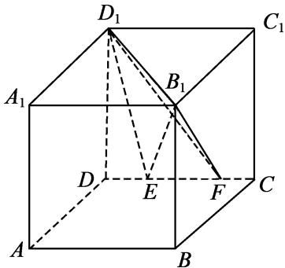

# Mathematics - 题目 2115

**ID**: 880afc0df8cf4ae888a940fde6b4141b
**年级**: Grade 12
**难度**: Medium
**题型**: Multiple-choice

## 题目
如图，设 $E,F$ 分别是长方体 $ABCD-A{{}_{1}}B{{}_{1}}C{{}_{1}}D{{}_{1}}$ 棱 $CD$ 上的两个动点，点 $E$ 在点 $F$ 的左边，且满足 $2EF=DC{\rm{=}}\frac {1}{2}BC$ ，有下列结论：① $B{{}_{1}}D{{}_{1}}\bot $ 平面 $B{{}_{1}}EF$ ；​​​​​​​‌②三棱锥 $D{{}_{1}}-B{{}_{1}}EF$ 体积为定值；③ $A{{}_{1}}A//$ 平面 $B{{}_{1}}EF$ ；④平面 $A{{}_{1}}ADD{{}_{1}}\bot $ 平面 $B{{}_{1}}EF$ ；其中，所有正确结论的序号是（      ）

## 解答

1. $B{{}_{1}}D{{}_{1}}$ 与 $D{{}_{1}}C{{}_{1}}$ 显然不垂直，而 $EF//C{{}_{1}}D{{}_{1}}$ ，因此 $B{{}_{1}}D{{}_{1}}$ 与 $EF$ 显然不垂直，从而 $B{{}_{1}}D{{}_{1}}\bot $ 平面 $B{{}_{1}}EF$ 是错误的，①错；
2. $V{{}_{D{{}_{1}}-B{{}_{1}}EF}}=V{{}_{B{{}_{1}}-D{{}_{1}}EF}}$ ，三棱锥 $B{{}_{1}}-D{{}_{1}}EF$ 中，平面 $D{{}_{1}}EF$ 即平面 $CDD{{}_{1}}C{{}_{1}}$ ， $B{{}_{1}}$ 到平面 $CDD{{}_{1}}C{{}_{1}}$ 的距离为 $B{{}_{1}}C{{}_{1}}$ 是定值， $\vartriangle D{{}_{1}}EF$ 中， $EF$ 的长不变， $D{{}_{1}}$ 到 $EF$ 的距离不变，面积为定值，因此三棱锥体积是定值，②正确；
3. 平面 $B{{}_{1}}EF$ 就是平面 $B{{}_{1}}A{{}_{1}}DC$ ，而 $AA{{}_{1}}$ 与平面 $B{{}_{1}}A{{}_{1}}DC$ 相交，③错；
4. 长方体中 $CD\bot $ 平面 $A{{}_{1}}D{{}_{1}}DA$ ， $CD\subset $ 平面 $B{{}_{1}}A{{}_{1}}DC$ ，所以平面 $A{{}_{1}}D{{}_{1}}DA$  $\bot $ 平面 $B{{}_{1}}A{{}_{1}}DC$ ，即平面 $A{{}_{1}}ADD{{}_{1}}\bot $ 平面 $B{{}_{1}}EF$ ，④正确．
5. 故选：C．

## 知识点

**中文**:
  - 平面与平面垂直的判定
  - 棱柱、棱锥、棱台的体积
  - 直线与平面平行的判定
  - 直线与平面垂直的判定

**English**:
  - Plane-Plane Perpendicularity Determination
  - Volume of Polyhedra
  - Line-Plane Parallelism Determination
  - Line-Plane Perpendicularity Determination

---
