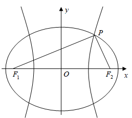

# Mathematics - 题目 3510

**ID**: 9f8652f765ea493496bb54f55b5848c0
**年级**: Grade 12
**难度**: Medium
**题型**: Multiple-choice

## 题目
已知椭圆 $C{{}_{1}}$ 与双曲线 $C{{}_{2}}$ 的焦点相同，离心率分别为 $e{{}_{1}}$ ， $e{{}_{2}}$ ，且满足 $e{{}_{2}}=\sqrt {5}e{{}_{1}}$ ， $F{{}_{1}}$ ， $ F{{}_{2}}$ 是它们的公共焦点，P是椭圆和双曲线在第一象限的交点，若 $\angle F{{}_{1}}PF{{}_{2}}=120{}^\circ $ ，则双曲线 $C{{}_{2}}$ 的离心率为（      ）​​​​​​​‌

## 解答

1. 设 $\left |{PF{{}_{1}}}\right |=r{{}_{1}}$  ，  $\left |{PF{{}_{2}}}\right |=r{{}_{2}}$ ，
2. 在椭圆 $C{{}_{1}}$ ： $\frac {x{^{2}}}{a{{}_{1}}{^{2}}}+\frac {y{^{2}}}{b{{}_{1}}{^{2}}}=1$ 中，
3. ${\left({2c}\right)^{2}}=r{{}_{1}}{^{2}}+r{{}_{2}}{^{2}}-2r{{}_{1}}r{{}_{2}}{\rm{c}}{\rm{o}}{\rm{s}}120{^{\circ }}$
4. $={\left({r{{}_{1}}+r{{}_{2}}}\right)^{2}}-r{{}_{1}}r{{}_{2}}={\left({2a{{}_{1}}}\right)^{2}}-r{{}_{1}}r{{}_{2}}$ ，
5. $\therefore r{{}_{1}}r{{}_{2}}=4a{{}_{1}}{^{2}}-4c{^{2}}=4b{{}_{1}}{^{2}}$ ，
6. 在双曲线 $C{{}_{2}}$ ： $\frac {x{^{2}}}{a{{}_{2}}{^{2}}}-\frac {y{^{2}}}{b{{}_{2}}{^{2}}}=1$ 中，
7. ${\left({2c}\right)^{2}}=r{{}_{1}}{^{2}}+r{{}_{2}}{^{2}}-2r{{}_{1}}r{{}_{2}}{\rm{c}}{\rm{o}}{\rm{s}}{\rm{1}}{\rm{2}}0{^{\circ }}$
8. $={\left({r{{}_{1}}-r{{}_{2}}}\right)^{2}}+3r{{}_{1}}r{{}_{2}}={\left({2a{{}_{2}}}\right)^{2}}+3r{{}_{1}}r{{}_{2}}$
9. $\therefore 3r{{}_{1}}r{{}_{2}}=4c{^{2}}-4a{{}_{2}}{^{2}}=4b{{}_{2}}{^{2}}\Rightarrow r{{}_{1}}r{{}_{2}}=\frac {4b{{}_{2}}{^{2}}}{3}$ ，
10. $\therefore \frac {4}{3}b{{}_{2}}{^{2}}=4b{{}_{1}}{^{2}}$ 即 $b{{}_{2}^{2}}=3b{{}_{1}^{2}}$ ，则 $a{{}_{2}^{2}}-c{^{2}}=3\left ({c{^{2}}-a{{}_{1}^{2}}}\right )$
11. 所以 $a{{}_{2}^{2}}+3a{{}_{1}^{2}}=4c{^{2}}\Rightarrow \frac {a{{}_{2}^{2}}}{c{^{2}}}+\frac {3a{{}_{1}^{2}}}{c{^{2}}}=4\Rightarrow \frac {1}{e{{}_{2}}{^{2}}}{\rm{+}}\frac {3}{e{{}_{1}}{^{2}}}=4$ ，
12. 又因为 $e{{}_{2}}=\sqrt {5}e{{}_{1}}$ ，所以 $\frac {1}{e{{}_{2}}{^{2}}}{\rm{+}}\frac {15}{e{{}_{2}}{^{2}}}=4$ ，
13. 解得 $e{{}_{2}}=2$ ，
14. 故选：C.

## 知识点

**中文**:
  - 圆锥曲线性质综合应用

**English**:
  - Comprehensive Application of Properties

---
