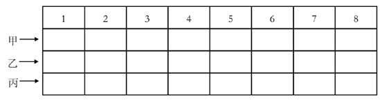

# Mathematics - 题目 1866

**ID**: a20410f0e39b48c0b045a011cad0d88f
**年级**: Grade 12
**难度**: Medium
**题型**: Multiple-choice

## 题目
甲､乙､丙三人手持黑白两色棋子，在3行8列的网格中，三人同时从左到右，从1号位置摆到8号位置，若甲的1号位置与乙的1号位置颜色相同，称甲乙对应位置相同，反之称甲乙对应位置不同，则下列情况可能的是（      ）​​​​​​​‌

## 解答

1. 对A，若甲乙有3个对应位置不同，不妨设前3个对应位置不同，则后5个对应位置相同，
2. 若丙和甲、丙和乙都要有3个对应位置不同，则只能在后5个对应位置中有3个和甲乙不同，若丙和甲在后5个对应位置中有3个对应位置不同，则必和乙有6个位置不同，故A错误；
3. 对B，若甲和乙前4个对应位置不同，乙和丙后4个对应位置不同，则甲和丙后4个对应位置也不同，故存在，所以B错误；
4. 对C，若甲乙第1个位置不同，后7个位置相同，甲丙在后7个位置中有3个位置不同，此时乙丙最多有4个位置不同，故C错误；
5. 对D，若甲乙前3个位置不同，甲丙第3个到第6个位置不同，则成立，故D正确.
6. 故选：D.

## 知识点

**中文**:
  - 其它有限制条件的排列问题

**English**:
  - Other Restricted Permutation Problems

---
