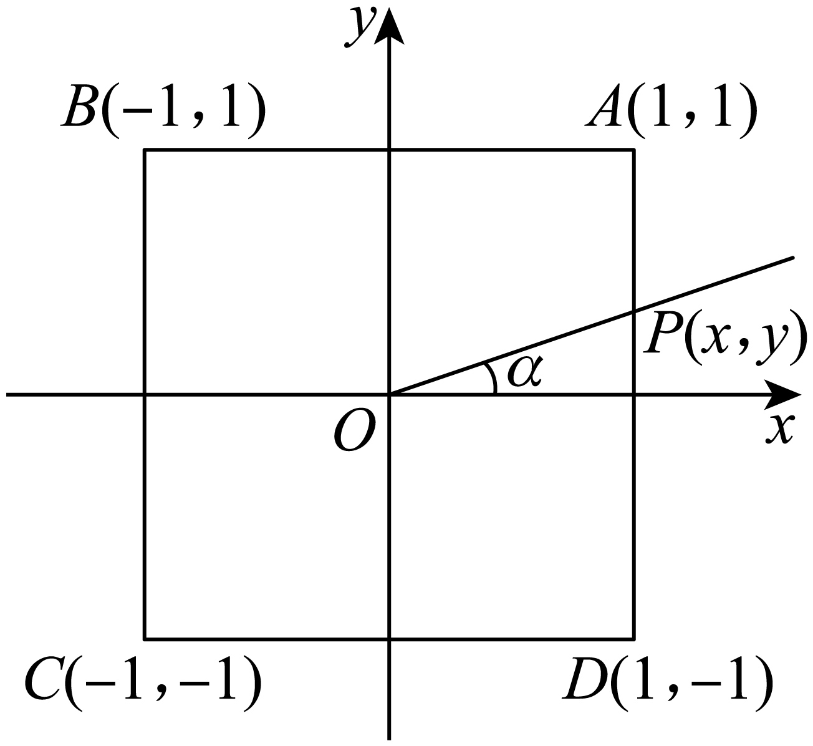

# Mathematics - 题目 535

**ID**: a5a1fb1930fd43ee87124220655be6e3
**年级**: Grade 12
**难度**: Medium
**题型**: Multiple-choice

## 题目
如图所示，在平面直角坐标系中， $\angle α$ 的终边 $OP$ 与正方形 $ABCD$ 交于点 $P\left ({x,y}\right )$ ，我们定义 $\angle α$ 的类余弦值 $L{\rm{c}}{\rm{o}}{\rm{s}}α=x$ ，类正弦值 $L{\rm{s}}{\rm{i}}{\rm{n}}α=y$ .​​​​​​​‌则下面叙述正确的是（      ）

## 解答

1. 对于AB，当 $α=\frac {{\rm{π}}}{4}$ 时， $L{\rm{c}}{\rm{o}}{\rm{s}}α=L{\rm{s}}{\rm{i}}{\rm{n}}α=1$ ， $(L{\rm{c}}{\rm{o}}{\rm{s}}α){^{2}}+(L{\rm{s}}{\rm{i}}{\rm{n}}α){^{2}}=2>1,L{\rm{c}}{\rm{o}}{\rm{s}}α+L{\rm{s}}{\rm{i}}{\rm{n}}α=2>\sqrt {2}{\rm ，AB}$ 错误；
2. 对于 ${\rm C，}L{\rm{c}}{\rm{o}}{\rm{s}}\frac {5}{4}{\rm{π}}=L{\rm{c}}{\rm{o}}{\rm{s}}{\rm{π}}=-1{\rm ，C}$ 错误；
3. 对于D，正方形 $ABCD$ 关于直线 $y=x$ 对称， $\angle α$ 和 $\frac {{\rm{π}}}{2}-\angle α$ 的终边也关于直线 $y=x$ 对称，
4. 则 $\angle α$ 和 $\frac {{\rm{π}}}{2}-\angle α$ 的终边和正方形 $ABCD$ 的交点也关于直线 $y=x$ 对称，所以 $L{\rm{c}}{\rm{o}}{\rm{s}}(\frac {{\rm{π}}}{2}-α)=L{\rm{s}}{\rm{i}}{\rm{n}}α{\rm ，D}$ 正确.
5. 故选D

## 知识点

**中文**:
  - 三角函数中的新定义问题
  - 终边相同的角及表示

**English**:
  - New Definition Problems
  - Coterminal Angles

---
