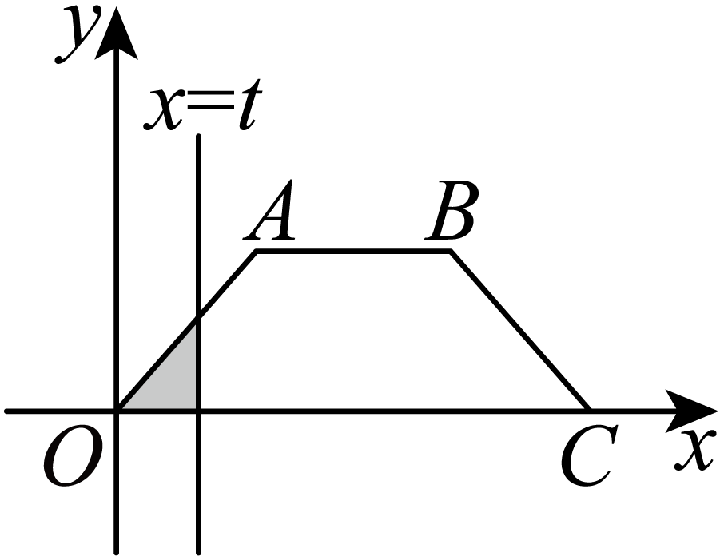

# Mathematics - 题目 3715

**ID**: bb4d9f3cdcf5474085c2fa446c84b817
**年级**: Grade 12
**难度**: Medium
**题型**: Multiple-choice

## 题目
如图，梯形 $OABC$ 是上底为 $\sqrt{2}$ ，下底为 $3\sqrt{2}$ ，高为 $\sqrt{2}$ 的等腰梯形，记梯形 $OABC$ 位于直线 $x=t(t>0)$ 左侧的阴影部分的面积为 $f(t)$ ，则 $y=f(t)$ 的大致图象是（      ）​​​​​​​‌

## 解答

1. 根据题意可知在梯形 $OABC$ 中， $\angle AOC=\angle OCB={45}^{\circ }$ ；
2. 当 $0<t\leqslant \sqrt{2}$ 时，阴影部分为等腰直角三角形，其面积为 $f(t)=\frac{1}{2}{t}^{2}$ ；
3. 当 $\sqrt{2}<t<2\sqrt{2}$ 时，阴影部分为等腰直角三角形加上一个矩形，
4. 其面积为 $f(t)=\frac{1}{2}×{\left(\sqrt{2}\right)^{2}}+\sqrt{2}(t-\sqrt{2})=\sqrt{2}t-1$ ；
5. 当 $t\geqslant 2\sqrt{2}$ 时，阴影部分面积为整个梯形面积减去右侧空白部分表面积，
6. 即 $f(t)=\frac{1}{2}(\sqrt{2}+3\sqrt{2})×\sqrt{2}-\frac{1}{2}{\left(3\sqrt{2}-t\right)^{2}}=-\frac{1}{2}{t}^{2}+3\sqrt{2}t-5$ ；
7. 所以可得 $f(t)=\begin{cases}\frac{1}{2}{t}^{2},0<t\leqslant \sqrt{2}\\\sqrt{2}t-1,\sqrt{2}<t<2\sqrt{2}\\-\frac{1}{2}{t}^{2}+3\sqrt{2}t-5,2\sqrt{2}\leqslant t\leqslant 3\sqrt{2}\end{cases}$ ；
8. 根据函数类型对比图象可得A正确.
9. 故选A

## 知识点

**中文**:
  - 函数图象的应用

**English**:
  - Applications of Function Graphs

---
