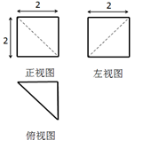

# Mathematics - 题目 1906

**ID**: d5c3192393004c6ead1e01385660fd9c
**年级**: Grade 12
**难度**: Medium
**题型**: Multiple-choice

## 题目
如图是一个几何体的三视图，则该几何体的表面积为​​​​​​​‌

## 解答

1. 由三视图还原该几何体如图: ${\rm{S}}-{\rm{A}}{\rm{B}}{\rm{C}}{\rm{D}}$
2. 
3. 其表面积为： $S{{}_{S-{\rm{A}}{\rm{B}}{\rm{C}}{\rm{D}}}}=S{{}_{{\rm{A}}{\rm{B}}{\rm{C}}{\rm{D}}}}+S{{}_{Δ{\rm{S}}{\rm{B}}{\rm{C}}}}+S{{}_{Δ{\rm{S}}{\rm{A}}{\rm{B}}}}+S{{}_{ΔSAD }}+S{{}_{ΔSCD}}=4\sqrt {2}+2+2+2+2\sqrt {3}=4\sqrt {2}+2\sqrt {3}+6$ ，
4. 故选D

## 知识点

**中文**:
  - 棱柱、棱锥、棱台的体积
  - 直观图与三视图之间的互化

**English**:
  - Volume of Polyhedra
  - Conversion between Views

---
