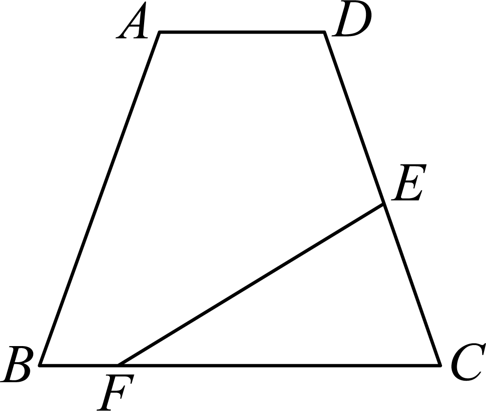

# Mathematics - 题目 3481

**ID**: e3db6b6790f84494bb10976beb519f32
**年级**: Grade 12
**难度**: Medium
**题型**: Multiple-choice

## 题目
如图，在等腰梯形 $ABCD$ 中， $AD//BC$ ， $AB=BC=CD=3AD$ ，点 $E$ 为线段 $CD$ 的中点，点 $F$ 是线段 $BC$ 上一点，且 $\overrightarrow {{FE}}=λ(\overrightarrow {{BC}}+\overrightarrow {{BA}})$ ，则 $\frac {BF}{BC}=$ （      ）​​​​​​​‌

## 解答

1. 由等腰梯形 $ABCD$ 中， $AD//BC$ ， $AB=BC=CD=3AD$ ，点 $E$ 为线段 $CD$ 的中点，
2. 由点 $F$ 是线段 $BC$ 上一点，设 $\overrightarrow {{BF}}=m\overrightarrow {{BC}}$ ，
3. 则 $\overrightarrow {{FE}}=\overrightarrow {{FC}}+\overrightarrow {{CE}}=(1-m)\overrightarrow {{BC}}+\frac {1}{2}\overrightarrow {{CD}}=(1-m)\overrightarrow {{BC}}+\frac {1}{2}(\overrightarrow {{BD}}-\overrightarrow {{BC}})$
4. $=(1-m)\overrightarrow {{BC}}+\frac {1}{2}[(\overrightarrow {{BA}}+\overrightarrow {{AD}})-\overrightarrow {{BC}}]=(1-m)\overrightarrow {{BC}}+\frac {1}{2}[(\overrightarrow {{BA}}+\frac {1}{3}\overrightarrow {{BC}})-\overrightarrow {{BC}}]$
5. $=(1-m)\overrightarrow {{BC}}+\frac {1}{2}(\overrightarrow {{BA}}-\frac {2}{3}\overrightarrow {{BC}})=(\frac {2}{3}-m)\overrightarrow {{BC}}+\frac {1}{2}\overrightarrow {{BA}}$ ，
6. 因为 $\overrightarrow {{FE}}=λ(\overrightarrow {{BC}}+\overrightarrow {{BA}})$ ，可得 $\begin{cases}\frac {2}{3}-m=λ\\\frac {1}{2}=λ\end{cases}$ ，解得 $m=\frac {1}{6},λ=\frac {1}{2}$ ，
7. 所以 $\overrightarrow {{BF}}=\frac {1}{6}\overrightarrow {{BC}}$ ，所以 $\frac {BF}{BC}=\frac {1}{6}$ .
8. 故选C.
9. 

## 知识点

**中文**:
  - 向量的共线定理
  - 向量线性综合运算

**English**:
  - Collinearity Theorem
  - Comprehensive Linear Operations

---
