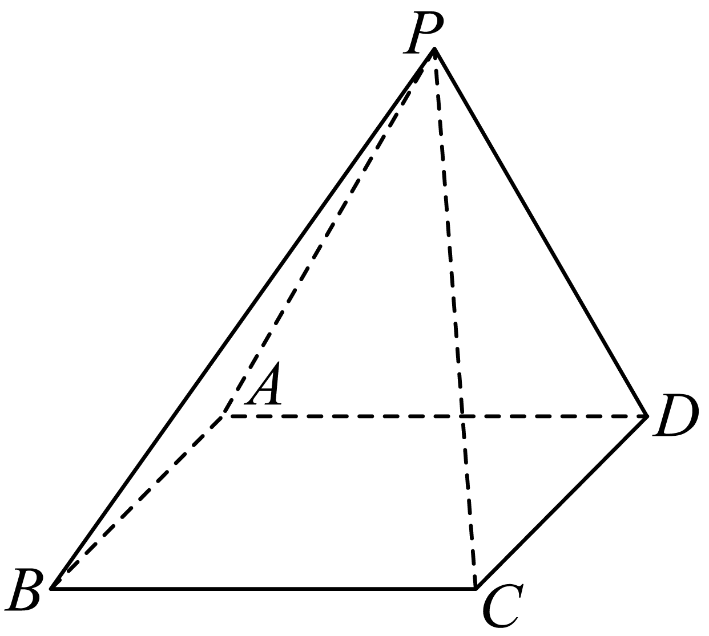

# Mathematics - 题目 2819

**ID**: e963d97d98ad43d995da0f23c1d0a1e8
**年级**: Grade 12
**难度**: Medium
**题型**: Multiple-choice

## 题目
如图，在四棱锥 $P-ABCD$ 中，底面 $ABCD$ 为矩形， $AB=2$ ， $\vartriangle PAD$ 是正三角形，平面 $PAD\bot $ 平面 $ABCD$ ，且 $V_{P-ABCD}=\frac {16\sqrt {3}}{3}$ ，则 $PC$ 与平面 $PAD$ 所成角的正切值为（      ）​​​​​​​‌

## 解答

1. 取 $AD$ 的中点 $O$ ，连接 $PO$ ，
2. 由已知 $\vartriangle PAD$ 为等边三角形，所以 $PO\bot AD$ ，
3. 又平面 $PAD\bot $ 平面 $ABCD$ ，平面 $PAD\cap $ 平面 $ABCD=AD$ ，
4. $PO⊂$ 平面 $PAD$ ，
5. 所以 $PO⊥$ 平面 $ABCD$ ，
6. 设 $PD=x$ ，则 $PO=\frac {\sqrt {3}}{2}x$ ， $AD=x$ ，又 $AB=2$ ，
7. 所以矩形 $ABCD$ 的面积 $S_{ABCD}=2x$ ，
8. 所以四棱锥 $P-ABCD$ 的体积 $V_{P-ABCD}=\frac {1}{3}\times S_{ABCD}\times PO=\frac {1}{3}\times 2x\times \frac {\sqrt {3}}{2}x=\frac {\sqrt {3}}{3}x^{2}$ ，
9. 所以 $\frac {\sqrt {3}}{3}x^{2}=\frac {16\sqrt {3}}{3}$ ，所以 $x=4$ ，
10. 所以 $PD=4$ ，
11. 因为平面 $PAD\bot $ 平面 $ABCD$ ， $CD\bot AD$ ，
12. 平面 $PAD\cap $ 平面 $ABCD=AD$ ， $CD\subset $ 平面 $ABCD$ ，
13. 所以 $CD\bot $ 平面 $PAD$ ，又 $PD\subset $ 平面 $PAD$ ，
14. 所以 $CD\bot PD$ ，
15. 所以 $△CDP$ 为直角三角形，斜边为 $PC$ ，
16. 因为 $CD\bot $ 平面 $PAD$ ，
17. 所以 $PC$ 与平面 $PAD$ 所成角的平面角为 $\angle CPD$ ，
18. 在 ${\rm{R}}{\rm{t}}△CDP$ 中， $CD=AB=2$ ， $PD=4$ ，
19. 所以 ${\tan}\angle CPD=\frac {CD}{PD}=\frac {1}{2}$ ，
20. $PC$ 与平面 $PAD$ 所成角的正切值为 $\frac {1}{2}$ .
21. 故选：B.
22. 

## 知识点

**中文**:
  - 棱柱、棱锥、棱台的体积
  - 直线与平面所成的角

**English**:
  - Volume of Polyhedra
  - Line-Plane Angle

---
