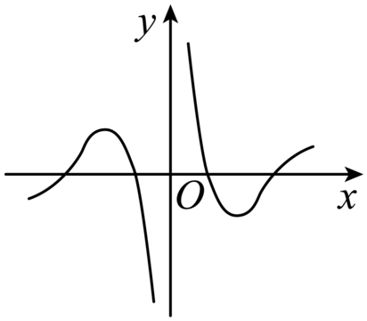

# Mathematics - 题目 1149

**ID**: ebb5677a64794a05bc0664cdec826558
**年级**: Grade 12
**难度**: Medium
**题型**: Multiple-choice

## 题目
已知函数 $y=f\left ({x}\right )$ 的图象如图所示，则此函数可能是（      ）​​​​​​​‌

## 解答

1. 对于A选项，由 $2{^{-x}}-2{^{x}}\ne 0$ 可得 $x\ne 0$ ，故函数 $f\left ({x}\right )=\frac {\sin 6x}{2{^{-x}}-2{^{x}}}$ 的定义域为 $\left \{x\left |{x\ne 0}\right .\right \}$ ，
2. 因为 $f\left ({-x}\right )=\frac {\sin \left ({-6x}\right )}{2{^{x}}-2{^{-x}}}=\frac {\sin 6x}{2{^{-x}}-2{^{x}}}=f\left ({x}\right )$ ，函数 $f\left ({x}\right )=\frac {\sin 6x}{2{^{-x}}-2{^{x}}}$ 为偶函数，不满足条件；
3. 对于B选项，由 $2{^{x}}-2{^{-x}}\ne 0$ 可得 $x\ne 0$ ，故函数 $f\left ({x}\right )=\frac {\sin 6x}{2{^{x}}-2{^{-x}}}$ 的定义域为 $\left \{x\left |{x\ne 0}\right .\right \}$ ，
4. 因为 $f\left ({-x}\right )=\frac {\sin \left ({-6x}\right )}{2{^{-x}}-2{^{x}}}=\frac {\sin 6x}{2{^{x}}-2{^{-x}}}=f\left ({x}\right )$ ，函数 $f\left ({x}\right )=\frac {\sin 6x}{2{^{x}}-2{^{-x}}}$ 为偶函数，不满足条件；
5. 对于C选项，由 $2{^{-x}}-2{^{x}}\ne 0$ 可得 $x\ne 0$ ，故函数 $f\left ({x}\right )=\frac {{\cos}6x}{2{^{-x}}-2{^{x}}}$ 的定义域为 $\left \{x\left |{x\ne 0}\right .\right \}$ ，
6. 因为 $f\left ({-x}\right )=\frac {{\cos}\left ({-6x}\right )}{2{^{x}}-2{^{-x}}}=-\frac {{\cos}6x}{2{^{-x}}-2{^{x}}}=-f\left ({x}\right )$ ，函数 $f\left ({x}\right )=\frac {{\cos}6x}{2{^{-x}}-2{^{x}}}$ 为奇函数，
7. 当 $0<x<\frac {π}{12}$ 时， $0<6x<\frac {π}{2}$ ， $2{^{x}}>2{^{-x}}$ ，则 $f\left ({x}\right )<0$ ，不满足条件；
8. 对于D选项，由 $2{^{x}}-2{^{-x}}\ne 0$ 可得 $x\ne 0$ ，故函数 $f\left ({x}\right )=\frac {{\cos}6x}{2{^{x}}-2{^{-x}}}$ 的定义域为 $\left \{x\left |{x\ne 0}\right .\right \}$ ，
9. 因为 $f\left ({-x}\right )=\frac {{\cos}\left ({-6x}\right )}{2{^{-x}}-2{^{x}}}=-\frac {{\cos}6x}{2{^{x}}-2{^{-x}}}=-f\left ({x}\right )$ ，函数 $f\left ({x}\right )=\frac {{\cos}6x}{2{^{x}}-2{^{-x}}}$ 为奇函数，
10. 当 $0<x<\frac {π}{12}$ 时， $0<6x<\frac {π}{2}$ ， $2{^{x}}>2{^{-x}}$ ，则 $f\left ({x}\right )>0$ ，满足条件.
11. 故选D.

## 知识点

**中文**:
  - 函数图象的识别

**English**:
  - Recognition of Function Graphs

---
