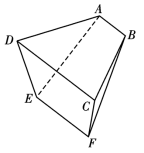

# Mathematics - 题目 1563

**ID**: f3ec8cc47d57411597b52cde93b3643f
**年级**: Grade 12
**难度**: Medium
**题型**: Multiple-choice

## 题目
中国古代数学家刘徽在《九章算术注》中记述：羡除，隧道也，其所穿地，上平下邪.​​​​​​​‌如图所示的五面体 $ABCDEF$ 是一个羡除，两个梯形侧面 $ABCD$ 与 $CDEF$ 相互垂直 ${\rm ，}AB//CD//EF$ .若 $AB=1{\rm ，}$  $EF=2{\rm ，}$  $CD=3{\rm ，}$ 梯形 $ABCD$ 与 $CDEF$ 的高分别为3和1，则该羡除的体积 $V=$ （      ）

## 解答

1. 在平面 $ABCD$ 内，过 $A{\rm ，}$  $B$ 两点分别作 $CD$ 的垂线，垂足分别为 $G{\rm ，}$  $H{\rm ，}$
2. 在平面 $CDEF$ 内，过 $G{\rm ，}$  $H$ 分别作 $GM\bot EF{\rm ，}$  $HN\bot EF{\rm ，}$ 垂足为 $M{\rm ，}$  $N$ .
3. 连接 $AM{\rm ，}$  $BN{\rm ，}$
4. 由平面 $ABCD$ 与平面 $CDEF$ 相互垂直，可知 $AG\bot MG{\rm ，}$  $BH\bot HN{\rm ，}$
5. 又 $AB//CD//EF{\rm ，}$ 易证平面 $AGM//$ 平面 $BHN{\rm ，}$ 且 $GH\bot $ 平面 $AGM{\rm ，}$
6. 所以几何体 $AGM-BHN$ 为直棱柱.因为 $AB//CD//EF{\rm ，}$  $AB=1{\rm ，}$  $EF=2{\rm ，}$  $CD=3{\rm ，}$ 梯形 $ABCD$ 与 $CDEF$ 的高分别为3和1，所以 $AG=BH=3{\rm ，}$  $GM=HN=1{\rm ，}$  $AB=GH=MN=1{\rm ，}$  $DG+HC=2{\rm ，}$  $EM+FN=1{\rm ，}$
7. 所以羡除 $ABCDEF$ 可以分割为两个直棱锥 $A-DEMG$ 和 $B-HNFC$ 和一个直棱柱 $AGM-BHN$ .
8. 故所几何体的体积 $V{{}_{五面体ABCDEF}}=V{{}_{直三棱柱AGM-BHN}}+V{{}_{四棱锥A-DEMG}}+V{{}_{四棱锥B-HNFC}}$  $=S{{}_{ΔAGM}}\cdot GH+\frac {1}{3}S{{}_{四边形DEMG}}\cdot AG+\frac {1}{3}S{{}_{四边形HNFC}}\cdot BH$  $=\frac {1}{2}\cdot AG\cdot GM\cdot GH+\frac {1}{3}\left ({\frac {DG+EM}{2}\cdot GM+\frac {HC+NF}{2}\cdot GM}\right )\cdot AG$  $=\frac {1}{2}AG\cdot GM\cdot GH+\frac {1}{3}\left ({\frac {DG+EM+HC+NF}{2}}\right )\cdot GM\cdot AG$
9. $=\frac {1}{2}\times 3\times 1\times 1+\frac {1}{3}\times \frac {2+1}{2}\times 1\times 3=3$ .
10. 故选A.
11. 

## 知识点

**中文**:
  - 简单组合体的表面积与体积

**English**:
  - Area and Volume of Composite Solids

---
