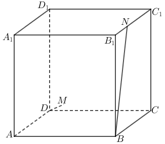

# Mathematics - 题目 3899

**ID**: f67c24827f2342e1a95777d4e19caf7d
**年级**: Grade 12
**难度**: Medium
**题型**: Multiple-choice

## 题目
已知点M是棱长为3的正方体 $ABCD-A{{}_{1}}B{{}_{1}}C{{}_{1}}D{{}_{1}}$ 的内切球O球面上的动点，点N为线段 $B{{}_{1}}C{{}_{1}}$ 上一点， $NC{{}_{1}}=2B{{}_{1}}N$ ， $DM\bot BN$ ，则动点M运动路线的长度为（      ）​​​​​​​‌

## 解答

1. 在正方体 $ABCD-A{{}_{1}}B{{}_{1}}C{{}_{1}}D{{}_{1}}$ 中，在BB_{1}上取点P，使B_{1}P=2BP，连接CP，DP，如图，
2. 
3. 因N在B_{1}C上，有 $NC{{}_{1}}=2B{{}_{1}}N$ ，即 $\frac {PB}{BC}=\frac {1}{3}=\frac {NB{{}_{1}}}{B{{}_{1}}B}$ ，则 ${\rm Rt}\vartriangle CBP\sim {\rm Rt}\vartriangle BB{{}_{1}}N$ ， $\angle CPB=\angle BNB{{}_{1}}$ ，于是得 $BN\bot CP$ ，
4. 而 $CD\bot $ 平面BCC_{1}B_{1}， $BN\subset $ 平面BCC_{1}B_{1}，则 $BN\bot CD$ ，又 $CD\cap CP=C$ ， $CD,CP\subset $ 平面CDP，则有 $BN\bot $ 平面CDP，
5. 因动点M满足 $DM\bot BN$ ，则有点M在平面CDP内，依题意，平面CDP截球O的截面小圆即为M的运动路线，
6. 令正方形BCC_{1}B_{1}与正方形ADD_{1}A_{1}的中心分别为E，F，连接EF，则正方体内切球球心O必为线段EF中点，
7. 显然，EF//CD， $EF\not\subset $ 平面CDP， $CD\subset $ 平面CDP，于是得EF//平面CDP，则点O到平面CDP距离等于点E到平面CDP的距离h，
8. 取BC中点G，连接EG，CE，PE，而平面CDP⊥平面BCC_{1}B_{1}，平面CDP$\cap $ 平面BCC_{1}B_{1}=CP，则 $△ECP$ 的边CP上的高等于h，
9. EG⊥BC， $EG=GC=\frac {3}{2}$ ，则 $CE=\frac {3\sqrt {2}}{2}$ ，直角梯形BGEP中， $BP=1,BG=\frac {3}{2}$ ，则 $EP=\sqrt {BG{^{2}}+(EG-BP){^{2}}}=\frac {\sqrt {10}}{2}$ ，
10. $△ECP$ 中， $CP=\sqrt {10}$ ，由余弦定理得 ${\cos}\angle CEP=\frac {EP{^{2}}+CE{^{2}}-CP{^{2}}}{2EP\cdot CE}=-\frac {\sqrt {5}}{5}$ ， ${\sin}\angle CEP=\frac {2\sqrt {5}}{5}$ ，
11. 由 $S{{}_{\vartriangle CEP}}=\frac {1}{2}CP\cdot h=\frac {1}{2}CE\cdot EP{\sin}\angle CEP$ 得： $h=\frac {\frac {3\sqrt {2}}{2}\times \frac {\sqrt {10}}{2}\times \frac {2\sqrt {5}}{5}}{\sqrt {10}}=\frac {3\sqrt {10}}{10}$ ，
12. 设点M运动路线的小圆半径为r，而球O的半径 $R=\frac {3}{2}$ ，由 $r{^{2}}+h{^{2}}=R{^{2}}$ 得 $r=\frac {3\sqrt {15}}{10}$ ， $2πr=\frac {3\sqrt {15}π}{5}$ ，
13. 所以动点M运动路线的长度为 $\frac {3\sqrt {15}π}{5}$ .
14. 故选：B

## 知识点

**中文**:
  - 动点问题
  - 球的切接问题
  - 截面问题

**English**:
  - Moving Point Problems
  - Tangency and Inscribed/Circumscribed Spheres
  - Cross-section Problems

---
