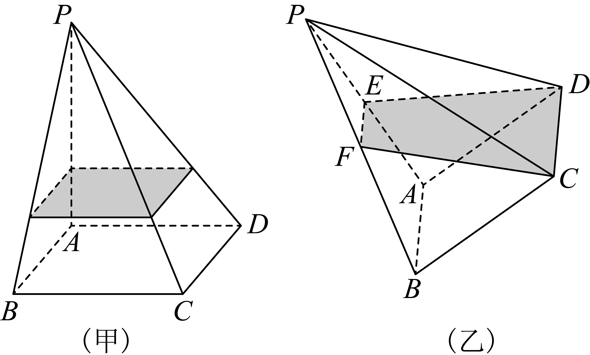

# Mathematics - 题目 2962

**ID**: 0034845e400342009d3661b103f0cde0
**年级**: Grade 12
**难度**: Medium
**题型**: Multiple-select

## 题目
某学校课外社团活动课上，数学兴趣小组进行了一次有趣的数学实验操作，课题名称“不用尺规等工具，探究水面高度”.​​​​​​​‌如图甲，是一个水平放置的装有一定量水的四棱锥密闭容器（容器材料厚度不计），底面为平行四边形，设棱锥高为，体积为，现将容器以棱为轴向左侧倾斜，如图乙，这时水面恰好经过，其中分别为棱的中点，则（      ）

## 解答

1. 如图将四棱锥补成平行六面体，设平行四面体的体积为，
2. 根据分别为棱的中点，
3. 则，而三棱柱与平行六面体的高相同，
4. 则，
5. 
6. 根据四棱锥与平行六面体底和高均相同，则，则
7. 易知，
8. 则，故A正确，B错误，
9. 图甲中上方的小四棱锥高为,则，则，
10. 
11. 故图甲中的水面高度为，故C正确,D错误；
12. 故选：AC.

## 知识点

**中文**:
  - 棱柱、棱锥、棱台的体积

**English**:
  - Volume of Polyhedra

---
