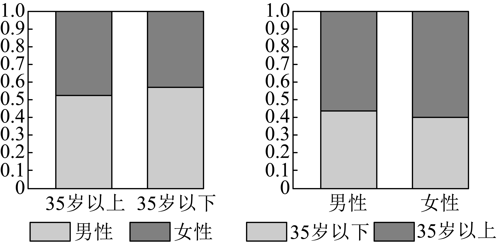

# Mathematics - 题目 2213

**ID**: 0579ff63cbae4d5087483bb81373f66f
**年级**: Grade 12
**难度**: Medium
**题型**: Multiple-select

## 题目
2020年12月26日太原地铁2号线开通，在一定程度上缓解了市内交通的拥堵状况，为了了解市民对地铁2号线开通的关注情况，某调查机构在地铁开通后两天抽取了部分乘坐地铁的市民作为样本，分析其年龄和性别结构．并制作出如下等高堆积条形图：根据图中信息，下列结论正确的是（      ）​​​​​​​‌

## 解答

1. 设等高条形图对应 $2\times 2$ 列联表如下：
2. 35岁及以上
3. 35岁以下
4. 总计
5. 男性
6. $a$
7. $c$
8. $a+c$
9. 女性
10. $b$
11. $d$
12. $b+d$
13. 总计
14. $a+b$
15. $c+d$
16. $a+b+c+d$
17. 根据第1个等高条形图可知，35岁及以上男性比35岁及以上女性多，即 $a>b;35$ 岁以下男性比”岁以下女性多，即 $c>d$ ．根据第2个等高条形图可知，男性中35岁及以上的比35岁以下的多，
18. 即 $a>c$ ；女性中35岁及以上的比35岁以下的多，即 $b>d$ ，对于A，男性人数为 $a+c$ ，女性人数为 $b+d$ ，因为 $a>b,c>d$ ，所以 $a+c>b+d$ ，所以A正确；
19. 对于 ${\rm B,}35$ 岁及以上女性人数为 $b,35$ 岁以下女性人数为 $d$ ，因为 $b>d$ ，所以B正确；
20. 对于 ${\rm C，}35$ 岁以下男性人数为 $c,35$ 岁及以上女性人数为 $b$ ，无法从图中直接判断 $b$ 与 $c$ 的大小关系，所以C不一定正确；
21. 对于D，35岁及以上的人数为 $a+b,35$ 岁以下的人数为 $c+d$ ，因为 $a>c,b>d$ ，所以 $a+b>c+d$ ，所以D正确．
22. 故选ABD.

## 知识点

**中文**:
  - 等高条形图

**English**:
  - Mosaic Plot (Equal-height Bar Chart)

---
