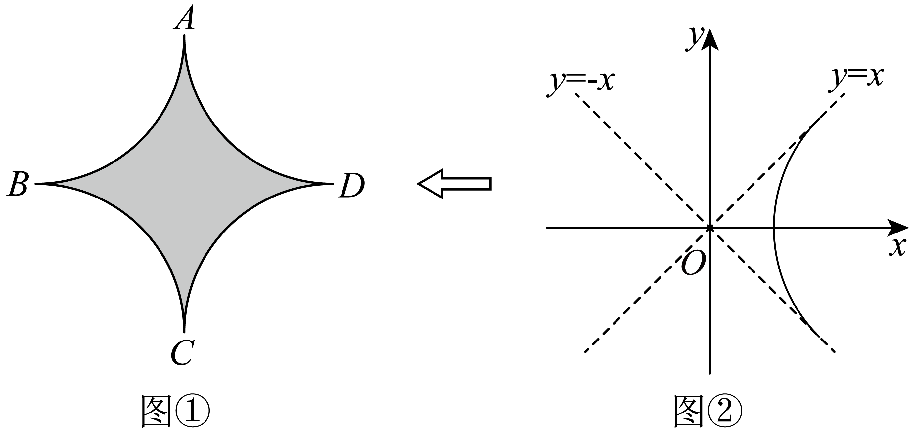

# Mathematics - 题目 3344

**ID**: 106eeafad8a247f687cc9d6136a8cc88
**年级**: Grade 12
**难度**: Medium
**题型**: Multiple-select

## 题目
“探索对称之美，感受数学魅力”，如图①的星形图案 $ABCD$ ，它可看作是由图②中的抛物线 $E:y{^{2}}=2p(x-1)(p>0)$ 绕坐标原点 $O$ 按逆时针方向分别旋转 $45{}\degree $ ， $135{}\degree $ ， $225{}\degree $ ， $315{}\degree $ 后所得的四条曲线围成的图形.​​​​​​​‌若 $\mathrm{A}$ ， $B$ ， $C$ ， $D$ 分别为相邻曲线的切点，则下列结论正确的是（      ）

## 解答

1. 
2. 对于A，由题意，知 $E$ 与直线 $y=x$ 相切，由 $\begin{cases}y{^{2}}=2p(x-1),\\y=x,\end{cases}$ 消去 $y$ ，整理得 $x{^{2}}-2px+2p=0$ .
3. 由 $\Delta =4p{^{2}}-8p=0$ ，得 $p=2$ ，故A正确；
4. 对于B，由选项A，知 $E$ 与直线 $y=x$ 的切点为 $P(2,2)$ ，则 $|OP|=2\sqrt {2}$ ，
5. 由题意，旋转后 $|OA|=|OD|=|OP|=2\sqrt {2}$ ，所以 $|AD|=4$ ，故B正确；
6. 对于C，如图，设直线 $y=x$ 与星形图案在第一象限的交点为 $M$ ，由 $E$ 的方程，知当 $y=0$ 时， $x=1$ ，即 $|OM|=1$ ，星形图案的面积 $S{{}_{阴影}}<4\left ({S{{}_{\vartriangle AOD}}-S{{}_{\vartriangle AMD}}}\right )=4\times \left ({4-2}\right )=8$ ，故C错误；
7. 对于D，直线 $y=x$ 与星形图案相交的弦长为 $2|OM|=2$ ，故D正确.
8. 故选ABD.

## 知识点

**中文**:
  - 由抛物线方程探究其几何性质

**English**:
  - Geometric Properties from Equation

---
