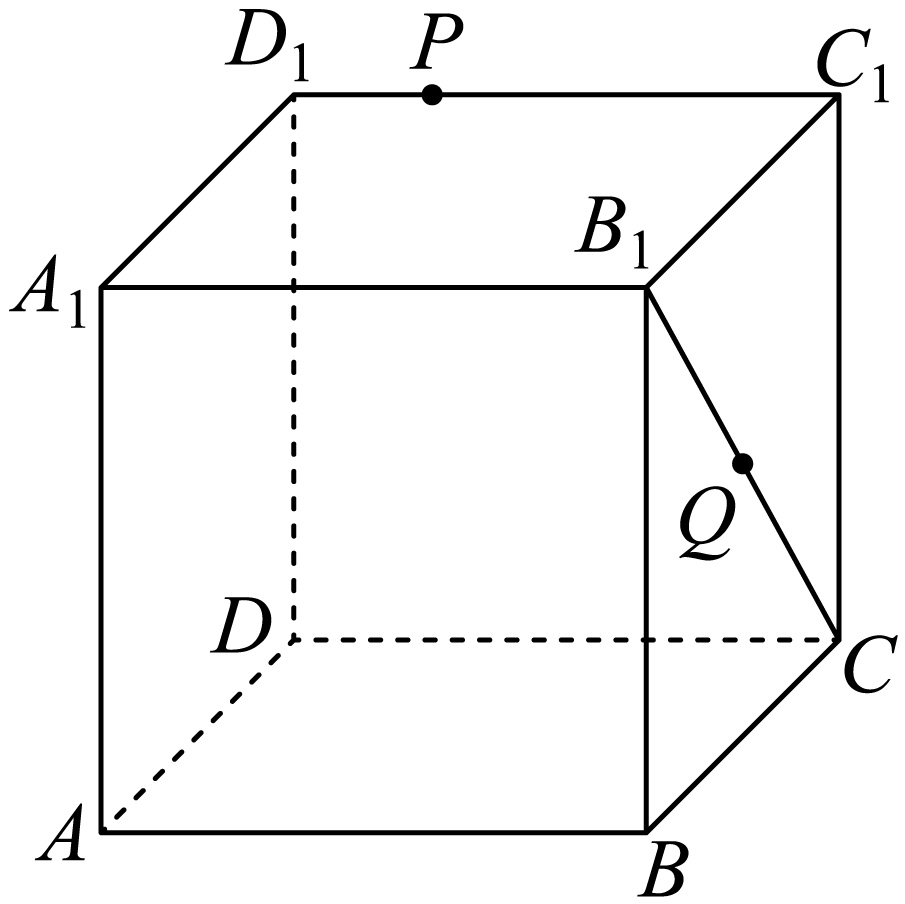

# Mathematics - 题目 2791

**ID**: 5de535180cb34ab8a283c30099961fd5
**年级**: Grade 12
**难度**: Medium
**题型**: Multiple-select

## 题目
已知正方体 $ABCD-A{{}_{1}}B{{}_{1}}C{{}_{1}}D{{}_{1}}$ 的棱长为 ${\rm 1，}P$ ， $Q$ 分别为棱 $C{{}_{1}}D{{}_{1}}$ ， $B{{}_{1}}C$ 上的动点，则（      ）​​​​​​​‌

## 解答

1. A：因为 $\vartriangle ABP$ 的面积为 $\frac {1}{2}AB\cdot BC{{}_{1}}=$  $\frac {\sqrt {2}}{2}$ ， $Q$ 到平面 $ABP$ 的距离不是定值，
2. 所以四面体 $PQAB$ 的体积不是定值，故A错误；
3. B：因为 $\mathrm{△}A{{}_{1}}DQ$ 的面积为 $\frac {1}{2}A{{}_{1}}D\cdot DC=\frac {\sqrt {2}}{2}{\rm ，\mathit{P}}$ 到矩形 $A{{}_{1}}B{{}_{1}}CD$ 的距离为定值 $\frac {\sqrt {2}}{2}$ ，
4. 所以 $P$ 到平面 $A{{}_{1}}DQ$ 的距离为 $\frac {\sqrt {2}}{2}$ ，则四面体 $PQA{{}_{1}}D$ 的体积为 $\frac {1}{3}S{{}_{\vartriangle A{{}_{1}}DQ}}\cdot \frac {\sqrt {2}}{2}=\frac {1}{6}$ ，故B正确；
5. C：当Q与 $B{{}_{1}}$ 重合时， $S{{}_{\mathrm{△}QAC}}$ 取得最大值，为 $\frac {1}{2}AB{{}_{1}}\cdot CB{{}_{1}}\sin 60^\circ =\frac {\sqrt {3}}{2}$ ，
6. 当 $P$ 与 $D{{}_{1}}$ 重合时， $P$ 到平面 $ACQ$ 的距离 ${\rm \mathit{d}}$ 取得最大值，
7. 在正 $\vartriangle ACB{{}_{1}}$ 中，其外接圆的半径为 $r=\frac {\sqrt {2}}{2\sin 60^\circ }=\frac {\sqrt {6}}{3}$ ，则 $d=\sqrt {(\sqrt {2}){^{2}}-r{^{2}}}=$  $\frac {2\sqrt {3}}{3}$ ，
8. 故四面体 $PQAC$ 的体积最大值为 $\frac {1}{3}\times \frac {\sqrt {3}}{2}\times \frac {2\sqrt {3}}{3}=\frac {1}{3}$ ，故C正确；
9. D：过点 $Q$ 作 $GH/\mskip-4mu/BC$ ， $PM\bot DG$ ， $PN\bot CD$ ，
10. 设 $CG=t$ ， $PD{{}_{1}}=s$ ，则 $t$ ， $s\in \left [0,1\right ]$ ，
11. $S{{}_{\mathrm{△}ADQ}}=\frac {1}{2}AD\times DG=\frac {1}{2}\sqrt {1+t{^{2}}}$ ， $PM=DG=\sqrt {1+t{^{2}}}$ ， $OM=DM\sin \angle CDG=\left ({t+s}\right )\frac {t}{\sqrt {1+t{^{2}}}}$ ， $OP=\sqrt {1+t{^{2}}}-\left ({s+t}\right )\cdot \frac {t}{\sqrt {1+t{^{2}}}}=\frac {1-st}{\sqrt {1+t{^{2}}}}$ ，
12. 故四面体 $PQAD$ 的体积为 $V=\frac {1}{3}\times \frac {1}{2}\sqrt {1+t{^{2}}}\times \frac {1-st}{\sqrt {1+t{^{2}}}}=\frac {1}{6}\left ({1-st}\right )$ ，其最大值为 $\frac {1}{6}$ ，故D正确．
13. 故选：BCD
14. 

## 知识点

**中文**:
  - 棱柱、棱锥、棱台的体积

**English**:
  - Volume of Polyhedra

---
