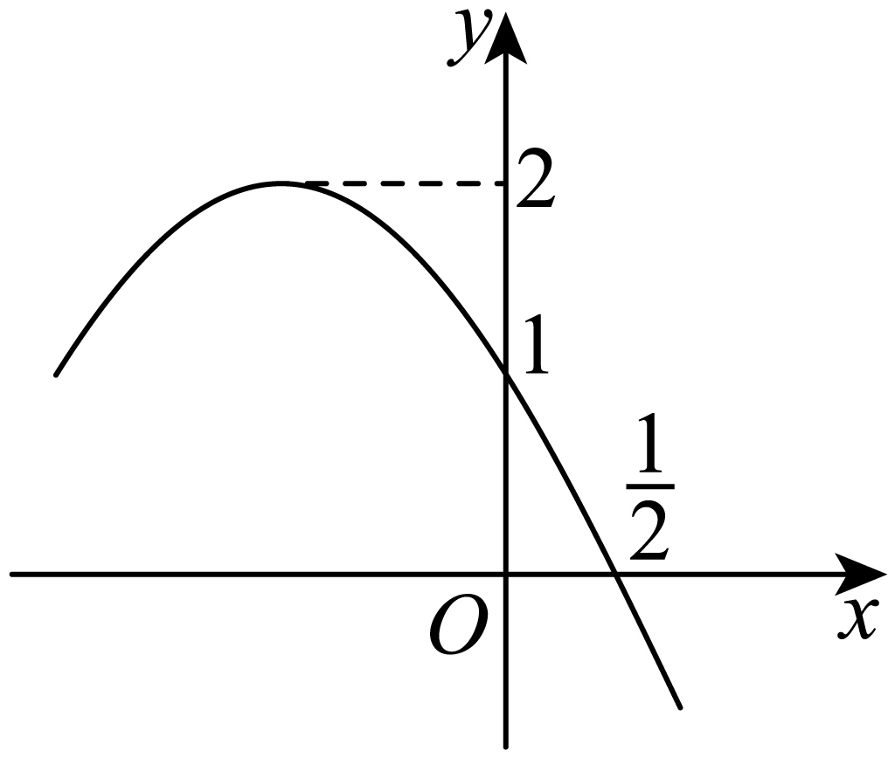

# Mathematics - 题目 3742

**ID**: 6b86695be8d940d19856870b707fab1a
**年级**: Grade 12
**难度**: Medium
**题型**: Multiple-select

## 题目
已知函数 $f\left ({x}\right )=A{\rm{s}}{\rm{i}}{\rm{n}}\left ({ωx+φ}\right )\left ({A>0,ω<0,\left |{φ}\right |<\frac {{\rm{π}}}{2}}\right )$ 的部分图象如图所示，则（      ）​​​​​​​‌

## 解答

1. 由图可知 $A=2$ ， $f(0)=2\sin φ=1$ ，
2. 所以 $\sin φ=\frac {1}{2}$ ，因为 $\left |{φ}\right |<\frac {{\rm{π}}}{2}$ ，所以 $φ=\frac {{\rm{π}}}{6}$ ，
3. 则 $f(x)=2\sin (ωx+\frac {{\rm{π}}}{6})$ ，
4. 又 $f(\frac {1}{2})=2\sin (\frac {ω}{2}+\frac {{\rm{π}}}{6})=0,ω<0$ ，
5. 所以 $\frac {ω}{2}+\frac {{\rm{π}}}{6}=2k{\rm{π}},k\in {\mathbf{Z}}$ ，则 $ω=-\frac {{\rm{π}}}{3}+4k{\rm{π}},k\in {\mathbf{Z}}$ ，
6. 又 $\frac {T}{4}=-\frac {2{\rm{π}}}{4ω}>\frac {1}{2}$ ，所以 $-{\rm{π}}<ω<0$ ，故 $ω=-\frac {{\rm{π}}}{3}$ ，
7. 则 $f(x)=2\sin (-\frac {{\rm{π}}}{3}x+\frac {{\rm{π}}}{6})$ ，则 $T=\frac {2{\rm{π}}}{\left |{ω}\right |}=6$ ，故A正确；
8. 由图象， $\left ({\frac {1}{2},0}\right )$ 是函数的一个对称中心，所以 $f(x)=f(1-x)=0$ 成立，故B正确；
9. 将 $f\left ({x}\right )$ 的图象向右平移 $\frac {1}{2}$ 个单位长度，则 $f(x-\frac {1}{2})=2\sin (-\frac {{\rm{π}}}{3}x+\frac {{\rm{π}}}{3})$ ，图象不关于原点对称，故C错误；
10. 当 $x\in \left [0,2\right ]$ 时， $-\frac {{\rm{π}}}{3}x+\frac {{\rm{π}}}{6}\in \left [-\frac {{\rm{π}}}{2},\frac {{\rm{π}}}{6}\right ]$ ，由正弦函数的单调性与复合函数单调性的判别方式可得 $f(x)$ 在区间 $\left [0,2\right ]$ 上单调递减，故D正确；
11. 故选ABD.

## 知识点

**中文**:
  - 三角函数的图象变换
  - 函数y=Asin（ωx＋φ）的图象和性质

**English**:
  - Transformation of Trigonometric Graphs
  - Graph and Properties of y=Asin(ωx+φ)

---
